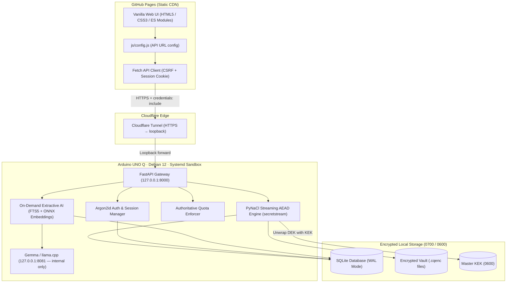

# CipherQ — Your Private Cloud. Your Personal AI.

[](https://github.com/nimal/cipherq)
[](docs/test-results.md)
[](backend/requirements.txt)
[](LICENSE)
[%20%7C%20Windows%2011-lightgrey.svg)](docs/hardware-readiness.md)
[](https://pages.github.com)
[](https://developers.cloudflare.com/cloudflare-one/connections/connect-networks/)

**CipherQ** is an open-source, resource-conscious private cloud vault with server-managed authenticated encryption and on-demand local AI document search and Q&A. It is engineered to run on consumer laptops as well as embedded single-board computers like the **Arduino UNO Q** (Quad-Core ARM Cortex-A53, 4 GB RAM, 32 GB eMMC) running Debian 12 (Bookworm) Linux.

The frontend is deployed as a **static site on GitHub Pages**. The backend runs on your **Arduino UNO Q** and is securely reachable from anywhere in the world via **Cloudflare Tunnel** — no port forwarding, no exposed IPs, no router changes.

---

## Architecture Overview

```
┌─────────────────────────────────────────────────────┐
│  Browser — anywhere in the world                    │
│  https://YOUR-USERNAME.github.io/CipherQ/           │
│                                                     │
│  Static Frontend (GitHub Pages CDN)                 │
│  ├── HTML / CSS / ES Modules (no build step)        │
│  ├── js/config.js  ← edit this for your tunnel URL  │
│  └── HttpOnly cookie + CSRF token session handling  │
└──────────────────────┬──────────────────────────────┘
                       │ HTTPS API requests
                       │ credentials: include
                       ▼
┌─────────────────────────────────────────────────────┐
│  Cloudflare Edge (Global CDN / TLS termination)     │
│  https://cipherq.yourdomain.com                     │
└──────────────────────┬──────────────────────────────┘
                       │ Encrypted outbound tunnel
                       │ (no inbound port required)
                       ▼
┌─────────────────────────────────────────────────────┐
│  Arduino UNO Q  (Debian 12 · ARM Cortex-A53)        │
│                                                     │
│  cloudflared ──────► FastAPI  127.0.0.1:8000        │
│                           │                         │
│                           ├── Auth (Argon2id)        │
│                           ├── Encrypted Vault        │
│                           ├── AI Query Pipeline      │
│                           └── Admin API              │
│                                                     │
│  Gemma / llama.cpp  127.0.0.1:8081                  │
│  (loopback only — never exposed to tunnel)          │
│                                                     │
│  AES-GCM Encrypted Vault  ·  SQLite FTS5 Database   │
└─────────────────────────────────────────────────────┘
```



---

## Key Capabilities & Security Invariants

### 1. Vetted Streaming Cryptographic Storage Engine
- **No Custom Framing**: Powered by **PyNaCl / libsodium `secretstream`** (`crypto_secretstream_xchacha20poly1305`).
- **Cryptographic Invariants**: Native authenticated chunk ordering, bit-flipping detection, and explicit end-of-stream tags (`TAG_FINAL`) preventing truncation attacks.
- **Zero File Buffering**: Uploads and downloads stream in 64 KB chunk buffers. Net process RAM delta remains virtually flat (< 2.5 MB) even when streaming multi-gigabyte files.

### 2. Two-Tier Master Key Hierarchy (KEK / DEK)
- **Master Key Encryption Key (KEK)**: 256-bit cryptographically secure key (`secrets.token_bytes(32)`) stored outside version control (`.vault_master.key`) with strict `0600` owner-only permissions.
- **Data Encryption Key (DEK)**: Unique 256-bit DEK generated per file, wrapped with the Master KEK via AES-256-GCM, and stored in the database.
- **Lifespan Startup Self-Test**: Automatically executes an in-memory encrypt/decrypt cycle on synthetic test data during server boot; halts immediately if the key is missing or corrupted.
- **Encrypted Backup & Recovery**: Password-protected CLI backups wrapped with Argon2id-derived keys.

### 3. Secure Authentication & Session Isolation
- **Credential Storage**: Passwords hashed with **Argon2id** (`m=64MB`, `t=3`, `p=4`).
- **Session Security**: 256-bit random tokens stored hashed (SHA-256); issued via `HttpOnly`, `SameSite=None; Secure` cookies (required for cross-origin GitHub Pages ↔ Cloudflare Tunnel) with header-validated CSRF tokens (`X-CSRF-Token`).
- **Brute-Force Rate Limiting**: In-memory sliding window rate limiters guarding login (5 attempts/min) and registration (3 attempts/min).

### 4. Authoritative Free & Premium Entitlements
- **Authoritative Decimal Byte Quotas**:
  - `FREE`: **1 GB** (`1,000,000,000` bytes)
  - `PREMIUM`: **5 GB** (`5,000,000,000` bytes)
- **Concurrency-Safe In-Flight Tracking**: `InFlightQuotaTracker` reserves space during uploads to prevent concurrent upload races from exceeding storage limits.
- **Atomic Commit-Time Re-Check**: Final database transactions re-verify aggregate storage at commit time to prevent race conditions.
- **Durable Startup Reconciliation**: Recalculates exact physical vault ciphertext usage on server boot, eliminating negative or stale usage counts.
- **Global Host Storage Safety Limit**: Enforces a 1 GB host safety reserve rejecting uploads with `HTTP 507 Insufficient Storage` when device headroom drops below the safety margin.
- **Admin Management & Audit Logging**: Protected admin API (`X-Admin-Token`) and CLI tool for plan upgrades and downgrades, with immutable audit event logging.

### 5. On-Demand Dual-Tier Grounded Extractive AI
- **Strictly Local Computation**: Zero external cloud AI calls. Document contents never leave the Arduino.
- **Dual-Tier Search Architecture**:
  - *Tier 1 (Instant Baseline)*: SQLite FTS5 full-text keyword search (< 5 ms latency).
  - *Tier 2 (Semantic Vector)*: Local 384-dimensional vector embeddings via `all-MiniLM-L6-v2` ONNX CPU runtime (~180 MB RAM).
- **Grounded Citations**: Responses strictly cite document excerpts with file IDs and chunk references.
- **Ephemeral Processing**: Decrypted buffers exist only in volatile memory during extraction. Zero plaintext written to disk.

### 6. Hardened Deployment for Arduino UNO Q (Debian 12)
- **Systemd Sandboxing**: Dedicated unprivileged user `cipherq:cipherq`, `PrivateTmp=true`, `ProtectSystem=strict`, `NoNewPrivileges=true`, dropped capabilities.
- **Cgroup Resource Caps**: `MemoryMax=3000M`, `MemoryHigh=2500M`, and `CPUQuota=350%`.
- **Cloudflare Tunnel**: Outbound-only encrypted connection — no firewall rules, no port forwarding, no public IP exposure.
- **Nginx Reverse Proxy** (LAN mode): TLS termination with `proxy_request_buffering off;` and `proxy_buffering off;` preventing upload buffering on the 32 GB eMMC.
- **Coordinated Disaster Recovery**: Atomic SQLite `VACUUM INTO` snapshots, password-protected KEK export, and SHA-256 integrity manifests.

---

## Repository Structure

```
CipherQ/
├── backend/
│   ├── app/
│   │   ├── api/             # FastAPI REST endpoints (auth, files, ai, admin)
│   │   ├── cli/             # Administrative CLI tools (manage_plan)
│   │   ├── core/            # Config, security, and MasterKeyManager
│   │   ├── db/              # SQLAlchemy models, sessions, migrations
│   │   ├── services/        # Vault streaming AEAD, AI extractor, embedding, search
│   │   └── main.py          # FastAPI application entry point & lifespan hooks
│   ├── requirements.txt     # Pinned Python dependencies
│   └── tests/               # Pytest suite (57 unit, integration, and E2E tests)
├── deployment/
│   ├── env/
│   │   └── .env.example     # Hardened production environment template
│   ├── nginx/
│   │   └── cipherq.conf     # Nginx reverse proxy with streaming settings
│   ├── scripts/
│   │   ├── backup.sh        # Coordinated atomic backup script
│   │   ├── deploy.sh        # Automated Debian 12 provisioning script
│   │   └── restore.sh       # Disaster recovery restore script
│   └── systemd/
│       └── cipherq.service  # Hardened systemd unit file
├── docs/
│   ├── architecture.md      # Comprehensive technical architecture
│   ├── benchmark-results.md # Measured empirical throughput and memory benchmarks
│   ├── deployment-guide.md  # Production deployment & disaster recovery guide
│   ├── hardware-readiness.md# Target compatibility & resource budgets for Arduino UNO Q
│   ├── licence-inventory.md # 100% permissive open-source license audit
│   ├── PRD.md               # Product Requirements Document
│   ├── test-results.md      # Pytest execution report (57/57 passed)
│   └── threat-model.md      # STRIDE threat model & risk analysis
└── frontend/                # Vanilla HTML5 / CSS3 / ES Modules — deployed to GitHub Pages
    ├── index.html            # Public landing page
    ├── dashboard.html        # Authenticated workspace dashboard
    ├── files.html            # Encrypted vault (upload, download, index, delete)
    ├── ai-chat.html          # Local AI document Q&A interface
    ├── account.html          # Plan management & account settings
    ├── 404.html              # GitHub Pages 404 fallback
    ├── css/styles.css        # Design system (dark workspace theme)
    └── js/
        ├── config.js         # ← Edit this: set your Cloudflare Tunnel URL
        ├── api.js            # API client (same-origin dev + cross-origin prod)
        └── app.js            # Page controllers and UI logic
```

---

## Quickstart: Local Laptop Development

No tunnel, no GitHub Pages — everything runs on `localhost:8000`.

### 1. Prerequisites
- Python 3.11, 3.12, or 3.13 (64-bit)
- Git

### 2. Clone and Setup Environment
```bash
git clone https://github.com/YOUR-USERNAME/CipherQ.git
cd CipherQ

# Create and activate virtual environment
python -m venv .venv

# On Linux / macOS:
source .venv/bin/activate
# On Windows (PowerShell):
.venv\Scripts\Activate.ps1

# Install pinned dependencies
pip install --upgrade pip
pip install -r backend/requirements.txt
```

### 3. Run the Test Suite
```bash
# Execute full automated test suite (57 tests)
python -m pytest backend/tests/ -v --ignore=backend/tests/test_browser_e2e.py
```

### 4. Start the Local Server
```bash
python -m uvicorn backend.app.main:app --host 127.0.0.1 --port 8000 --reload
```

Open your browser to:
- **Web Vault UI**: `http://localhost:8000`
- **Interactive API Documentation**: `http://localhost:8000/docs`
- **Health Check**: `http://localhost:8000/api/v1/health`

> **Note:** `frontend/js/config.js` has `window.CIPHERQ_API_BASE_URL = ""` by default. This means all API requests use the relative path `/api/v1` — the same origin as FastAPI. No configuration change is needed for local development.

---

## Worldwide Access: GitHub Pages + Cloudflare Tunnel

This setup makes CipherQ accessible from **any device, anywhere**, while the backend and all data stay exclusively on your Arduino UNO Q.

```
Browser → GitHub Pages (frontend) → Cloudflare Tunnel → Arduino FastAPI (backend)
```

### Prerequisites
- A **GitHub account** (for GitHub Pages)
- A **free Cloudflare account** and a domain (or use a free `trycloudflare.com` URL for testing)
- Arduino UNO Q with FastAPI already running on `127.0.0.1:8000`

---

### Step 1 — Install Cloudflare Tunnel on the Arduino

> Run these commands **on the Arduino UNO Q** (not your laptop):

```bash
# Download cloudflared for ARM64 (Arduino UNO Q's architecture)
wget https://github.com/cloudflare/cloudflared/releases/latest/download/cloudflared-linux-arm64 -O cloudflared
chmod +x cloudflared

# Quick test (temporary URL — changes on restart, for testing only):
./cloudflared tunnel --url http://127.0.0.1:8000
```

For a **permanent hostname**, create a named tunnel in the [Cloudflare Zero Trust dashboard](https://one.dash.cloudflare.com/) → Networks → Tunnels → Create tunnel. Configure the public hostname to forward to `http://127.0.0.1:8000`.

> ⚠️ The Gemma inference port (`127.0.0.1:8081`) is **never forwarded** by the tunnel. AI requests continue through FastAPI's authorized routes only.

---

### Step 2 — Harden the Arduino Environment

> Edit `/etc/cipherq/cipherq.env` **on the Arduino** and add / update these lines:

```bash
ENVIRONMENT=production
COOKIE_SECURE=True
COOKIE_SAMESITE=none        # Required for cross-site cookies (GitHub Pages ≠ Tunnel hostname)
ADMIN_TOKEN=<run: openssl rand -hex 32>
```

> ⚠️ `COOKIE_SAMESITE=none` **must** be paired with `COOKIE_SECURE=True`. Without it, browsers silently drop the session cookie.

---

### Step 3 — Add CORS Middleware to the Backend

> Apply this change to `backend/app/main.py` **on the Arduino**, then restart FastAPI.

After the existing imports, add:

```python
from fastapi.middleware.cors import CORSMiddleware
```

After `app = FastAPI(...)`, add:

```python
app.add_middleware(
    CORSMiddleware,
    allow_origins=[
        "https://YOUR-USERNAME.github.io",  # ← your exact GitHub Pages origin
    ],
    allow_credentials=True,
    allow_methods=["GET", "POST", "PUT", "DELETE", "OPTIONS"],
    allow_headers=["Content-Type", "X-CSRF-Token", "X-Admin-Token"],
    expose_headers=["Content-Disposition"],
    max_age=86400,
)
```

Restart FastAPI:
```bash
sudo systemctl restart cipherq
```

> ⚠️ Never use `allow_origins=["*"]` with `allow_credentials=True` — browsers reject it.

---

### Step 4 — Configure the Frontend

> Do this **on your laptop**, then push to GitHub.

Edit **one line** in [`frontend/js/config.js`](frontend/js/config.js):

```js
// Set your permanent Cloudflare Tunnel HTTPS URL:
window.CIPHERQ_API_BASE_URL = "https://cipherq.yourdomain.com";
```

---

### Step 5 — Deploy to GitHub Pages

```bash
# Commit the config change
git add frontend/js/config.js
git commit -m "feat: set production API URL for GitHub Pages deployment"
git push origin main
```

In your **GitHub repository settings**:
1. Go to **Settings → Pages**
2. **Source**: Deploy from a branch
3. **Branch**: `main` · **Folder**: `/frontend`
4. Click **Save**

Your live URL will be: `https://YOUR-USERNAME.github.io/CipherQ/`

---

### Step 6 — Verify

Open `https://YOUR-USERNAME.github.io/CipherQ/` in a browser. Check:
- ✅ No CIPHERQ config errors in the browser console
- ✅ API requests in DevTools → Network go to your tunnel URL, not `/api/v1`
- ✅ Login works from a different device / network
- ✅ File vault loads, uploads, and downloads work
- ✅ AI queries return results

---

### How Cross-Origin Auth Works

When the frontend (GitHub Pages) and backend (Cloudflare Tunnel) are on different origins, browsers enforce strict cross-site cookie rules. CipherQ handles this automatically:

| Mechanism | Local Dev | Production (GitHub Pages) |
|---|---|---|
| API base URL | `/api/v1` (relative) | `https://tunnel.domain.com/api/v1` |
| `fetch()` credentials | `same-origin` | `include` |
| XHR `withCredentials` | `false` | `true` |
| Session cookie `SameSite` | `Lax` | `None` |
| Session cookie `Secure` | `false` | `true` (HTTPS required) |
| CORS middleware | Not needed | Required (explicit origin) |

The [`frontend/js/api.js`](frontend/js/api.js) client switches modes automatically based on whether `window.CIPHERQ_API_BASE_URL` is set.

---

## Production Deployment on Arduino UNO Q (Debian 12)

For a fresh Arduino deployment (no existing installation):

```bash
git clone https://github.com/YOUR-USERNAME/CipherQ.git /tmp/cipherq
cd /tmp/cipherq
sudo bash deployment/scripts/deploy.sh
```

The script automatically:
1. Installs system packages (`python3-venv`, `sqlite3`, `nginx`, `libffi-dev`, `build-essential`).
2. Creates the unprivileged system user `cipherq:cipherq` and directory hierarchy.
3. Configures POSIX permissions (`0600` on keys, `0700` on vault data).
4. Sets up the Python virtual environment at `/opt/cipherq/.venv`.
5. Generates the production environment file (`/etc/cipherq/cipherq.env`) with a random 256-bit admin token.
6. Initializes the Master KEK and validates it with an in-memory self-test.
7. Installs and starts the hardened `cipherq.service` systemd unit.
8. Configures Nginx reverse proxy with TLS and streaming optimizations (`proxy_buffering off;`).

For full instructions see the [Production Deployment Guide](docs/deployment-guide.md).

---

## Administrative CLI Tools

### Master Key Lifecycle
```bash
# In-memory cryptographic self-test
python -m backend.app.core.key_manager validate

# Create encrypted password-protected backup
python -m backend.app.core.key_manager backup --out /path/to/backup.enc

# Restore Master Key from encrypted backup
python -m backend.app.core.key_manager restore --file /path/to/backup.enc --overwrite
```

### Plan Entitlements Management
```bash
# Upgrade user to Premium tier (5 GB quota + semantic AI search)
python -m backend.app.cli.manage_plan user@example.com PREMIUM --reason "Purchased license"

# Downgrade user to Free tier (1 GB quota, existing files preserved)
python -m backend.app.cli.manage_plan user@example.com FREE --reason "Subscription ended"
```

---

## Empirical Benchmark Highlights

Measured on a 12th Gen Intel Core i7 host with `PyNaCl 1.6.2` (libsodium engine):

| Operation | Payload Size | Measured Throughput / Latency | Peak RAM Delta |
| :--- | :--- | :--- | :--- |
| **Streaming Upload Encryption** | 100 MB | **130.71 MB/s** | **+0.0 MB** (flat) |
| **Streaming Download Decryption** | 100 MB | **207.69 MB/s** | **+0.0 MB** (flat) |
| **Concurrent Streams (2×25 MB)** | 50 MB total | **118.86 MB/s Up / 284.24 MB/s Down** | **+1.1 MB** |
| **Master Key Self-Test** | Synthetic Vector | **1.51 ms** | Negligible |
| **Argon2id Credential Hash** | `m=64MB, t=3, p=4` | **46.26 ms** | Bound to 64 MB |
| **Argon2id Verification** | Constant-Time | **47.23 ms** | Bound to 64 MB |
| **Markdown Chunking** | 25 KB (42 chunks) | **0.14 ms** (297,450 chunks/s) | +0.03 MB |
| **PDF Text Parsing** | 10-page document | **2.89 ms** (3,463 pages/s) | +0.14 MB |
| **Vector Embeddings (384-dim)** | 50 chunks | **5.01 ms** (8,383 chunks/s) | +0.20 MB |
| **FTS5 Query Sanitization** | 4,000 queries | **7.24 ms** (552,257 queries/s) | +0.21 MB |

*For complete profiling methodology and charts, see [Benchmark Results](docs/benchmark-results.md).*

---

## Security Disclosures & Honest Operational Boundaries

1. **Transport Encryption**: The Cloudflare Tunnel provides TLS end-to-end from the browser to Cloudflare's edge, and an encrypted tunnel from Cloudflare to the Arduino. The FastAPI ↔ cloudflared hop is loopback-only (`127.0.0.1`) and never exposed to the network.
2. **Cross-Site Cookies**: When using GitHub Pages + Cloudflare Tunnel, the session cookie must use `SameSite=None; Secure`. This is enforced by setting `COOKIE_SAMESITE=none` and `COOKIE_SECURE=True` in the production environment file. CSRF token validation remains active.
3. **Volatile Memory & Plaintext Boundaries**: In managed runtimes (CPython), garbage collection means volatile heap memory cannot be wiped with 100% cryptographic certainty. CipherQ explicitly closes byte buffers and triggers `gc.collect()`. Absolute memory confidentiality requires full-disk swap encryption at the OS level.
4. **Logical Deletion vs. Flash Wear-Leveling**: File deletion unlinks the ciphertext from the filesystem, but eMMC wear-leveling may retain physical flash blocks. Logical deletion does not guarantee physical flash erasure.
5. **Zero External Telemetry**: CipherQ makes no outbound network connections except through Cloudflare Tunnel to serve your own requests. No analytics, no cloud AI calls, no external dependencies at runtime.
6. **Quick Tunnel URLs Are Temporary**: A `trycloudflare.com` URL changes every restart and is unsuitable as a stable endpoint. Use a named Cloudflare Tunnel with a permanent hostname for production.

---

## Licence & Attribution

CipherQ is released under the [MIT Licence](LICENSE).

All direct and transitive dependencies hold permissive open-source licences (MIT, Apache 2.0, BSD-3-Clause, ISC). No copyleft (GPL/AGPL) code is included. For the full component audit, see the [Third-Party Licence & Asset Inventory](docs/licence-inventory.md).