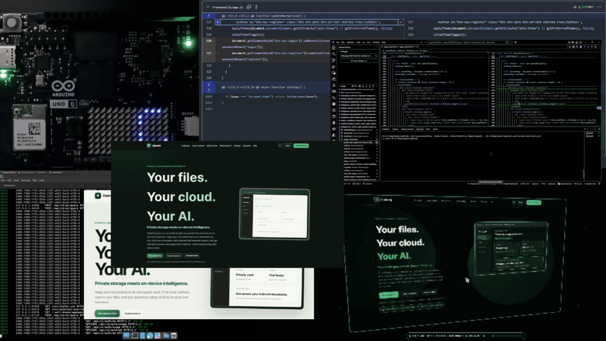
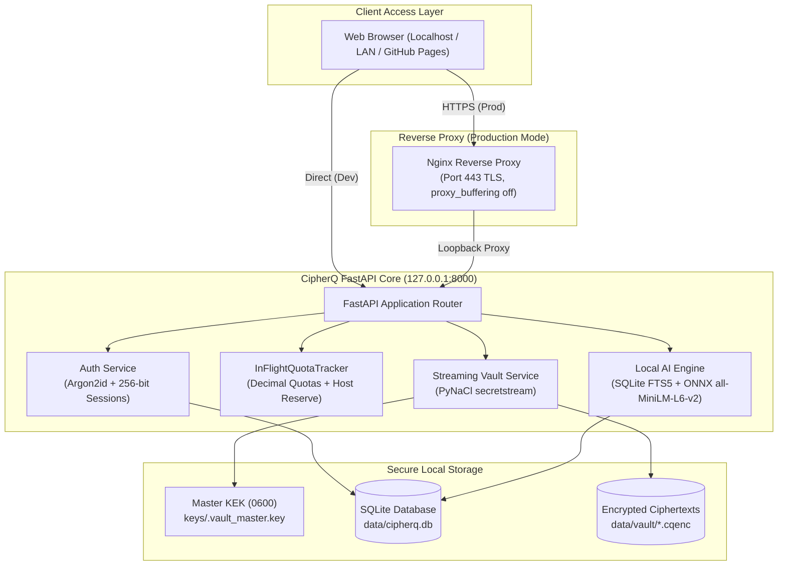

# CipherQ — Your Private Cloud. Your Personal AI.

[](LICENSE)
[](backend/requirements.txt)
[](https://fastapi.tiangolo.com)
[](docs/crypto-evaluation.md)
[%20%7C%20Windows%2011%20%7C%20Linux-lightgrey.svg)](docs/hardware-readiness.md)
[](docs/threat-model.md)

**CipherQ** is an open-source, resource-conscious private cloud vault engineered for individuals and small teams who demand full ownership of their data. It pairs **audited streaming authenticated encryption at rest** with an **on-demand, 100% local AI search and Q&A engine**—meaning your files and queries never leave your hardware.

Whether running locally on your laptop or hosted on compact single-board hardware such as the **Arduino UNO Q** (Quad-Core ARM Cortex-A53, 4 GB RAM, 32 GB eMMC running Debian 12 Bookworm), CipherQ delivers private file storage, full-text keyword retrieval, and local semantic intelligence within a strict, predictable memory footprint.

---

## Table of Contents

- [Overview & Architecture](#overview--architecture)
  - [Why CipherQ?](#why-cipherq)
  - [System Topology](#system-topology)
  - [Transparent Security Model](#transparent-security-model)
- [Key Features](#key-features)
- [Subscription Tiers & Quotas](#subscription-tiers--quotas)
- [Prerequisites](#prerequisites)
- [Quickstart: Local Development](#quickstart-local-development)
  - [1. Clone Repository](#1-clone-repository)
  - [2. Create & Activate Virtual Environment](#2-create--activate-virtual-environment)
  - [3. Install Dependencies](#3-install-dependencies)
  - [4. Environment Configuration](#4-environment-configuration)
  - [5. Master Key Initialization](#5-master-key-initialization)
  - [6. Start Backend Server](#6-start-backend-server)
  - [7. Explore Web Interface & API Docs](#7-explore-web-interface--api-docs)
- [Production Deployment (Debian 12 / Arduino UNO Q)](#production-deployment-debian-12--arduino-uno-q)
  - [Automated Provisioning](#automated-provisioning)
  - [Service Management](#service-management)
- [Configuration Reference](#configuration-reference)
- [Usage Guide](#usage-guide)
  - [Web Vault Interface](#web-vault-interface)
  - [Master Key CLI Tool](#master-key-cli-tool)
  - [User Plan Management CLI](#user-plan-management-cli)
  - [API Endpoints & Examples](#api-endpoints--examples)
- [Project Directory Structure](#project-directory-structure)
- [Backup & Disaster Recovery](#backup--disaster-recovery)
- [Troubleshooting & FAQs](#troubleshooting--faqs)
- [Running Tests & Benchmarks](#running-tests--benchmarks)
- [Contributing](#contributing)
- [Licence & Acknowledgements](#licence--acknowledgements)

---

## Overview & Architecture

### Why CipherQ?

Mainstream cloud storage providers (Google Drive, Dropbox, OneDrive) and cloud AI platforms hold decryption keys and frequently process, index, or train models on user data. CipherQ offers an alternative:

1. **Zero External Data Transmission**: Documents, vector embeddings, full-text indexes, and AI responses remain strictly on your local machine or single-board server.
2. **Streaming Authenticated Encryption (AEAD)**: Every file is encrypted using vetted libsodium `secretstream` (XChaCha20-Poly1305) in bounded 64 KB chunks, protecting against tampering, truncation, and byte reordering.
3. **Engineered for 4 GB RAM Hardware**: The entire stack is optimized for low-power ARM64 / x86_64 devices. Idle backend memory usage is `< 150 MB`, streaming transfers use `< 1 MB` RAM delta, and AI extraction is strictly on-demand.
4. **No Build Step Required**: The web UI is built with vanilla HTML5, CSS3, and modern ES modules—ready to serve directly from FastAPI or via a static CDN like GitHub Pages.

---

### System Topology



---

### Transparent Security Model

CipherQ operates with complete transparency regarding its security boundaries:

- **Server-Managed Vault (Not Zero-Knowledge E2EE)**: Because local document indexing, on-device AI search, and streaming downloads require server-side in-memory decryption, the server holds the Master Key Encryption Key (KEK).
- **Volatile Memory Handling**: Plaintext chunks exist only transiently in memory during active streaming or on-demand indexing. Buffers are explicitly closed, dereferenced, and garbage collected (`gc.collect()`). Zero unencrypted intermediate files are ever written to disk.
- **Physical Flash Caveat**: While logical deletion unlinks ciphertext and purges database records, physical flash media (e.g., eMMC wear-leveling) can retain underlying bits. Full-disk encryption (LUKS) is strongly recommended for host operating systems.

---

## Key Features

- 🔐 **Vetted Streaming AEAD Encryption**:
  - Every file receives a unique 256-bit Data Encryption Key (DEK).
  - DEK is encrypted under the server Master KEK using AES-256-GCM.
  - File payload is encrypted in 64 KB chunks via PyNaCl `secretstream` (`crypto_secretstream_xchacha20poly1305`).
  - Tamper, bit-flip, and truncation detection with verified authentication tags.
  - Plaintext SHA-256 digest computed on the fly during upload.

- 🤖 **On-Demand Local AI Engine**:
  - **Zero Background Processing**: Uploading files does **not** trigger resource-intensive background indexing; you choose when to index.
  - **In-Memory Text Parsing**: Decrypts directly into memory to parse `.txt`, `.md`, `.pdf`, `.json`, `.csv`, `.log`, and source code.
  - **Dual Search Modes**:
    - *Free Plan*: Instant full-text search with **SQLite FTS5** (~0 MB RAM overhead).
    - *Premium / AI Pro*: Hybrid search with **384-dimensional ONNX embeddings** (`all-MiniLM-L6-v2`, ~80 MB RAM).
  - **Grounded Citations**: AI answers explicitly cite the source file, chunk number, and exact page attribution (`[Source: manual.pdf, Page 4]`).
  - **Optional Local LLM**: Plugs directly into local loopback endpoints (such as `llama.cpp` hosting `gemma-3-1b-it-Q4_K_M.gguf` on `127.0.0.1:8081`).

- 📊 **Authoritative Quota & Host Headroom Enforcement**:
  - Strict decimal accounting (`1 GB = 1,000,000,000 bytes`).
  - `InFlightQuotaTracker`: Concurrency-safe upload reservations prevent race conditions.
  - **Host Headroom Safety Margin**: Rejects writes with `HTTP 507 Insufficient Storage` if free disk space on the host drops below `MIN_FREE_DISK_BYTES` (default: 1 GB), safeguarding the OS, logs, and SQLite WAL from corruption.
  - **Downgrade Preservation**: Downgrading preserves all existing encrypted files; new uploads are blocked with `HTTP 413` until total usage drops below the new quota.

- 🛡️ **Robust Web Security & Authentication**:
  - Passwords hashed using **Argon2id** (`m=64MB, t=3, p=4`).
  - Cryptographically random 256-bit session tokens stored hashed in SQLite.
  - Secure `HttpOnly`, `SameSite=Lax` (or `SameSite=None; Secure` for cross-origin setups) cookie management.
  - Strict header-based `X-CSRF-Token` validation on all mutating requests (`POST`, `PUT`, `PATCH`, `DELETE`).
  - Per-IP sliding-window rate limiting on login and registration attempts.

- 🔄 **Durable Maintenance & Disaster Recovery**:
  - Two-phase file deletion with persistent `cleanup_queue` table in SQLite.
  - Conservative startup reconciliation: verifies database and vault integrity, preserves recent in-flight temporary uploads (< 30 minutes old), cleans stale staging files, and quarantines orphaned files.
  - Encrypted, password-protected Master Key backup and restore CLI.

---

## Subscription Tiers & Quotas

CipherQ applies the same encryption standards across all plans. Plans differ by storage allowance and AI capabilities. Pay-as-you-go is planned for flexible storage expansion, with online billing integration currently in development.

| Feature | FREE | PREMIUM | VAULT AI | PAY-AS-YOU-GO |
| :--- | :---: | :---: | :---: | :---: |
| **Storage Allowance** | 1 GB | 5 GB | 5 GB | Flexible |
| **Encryption** | Streaming AEAD | Streaming AEAD | Streaming AEAD | Streaming AEAD |
| **File Operations** | Upload, Download, Delete | Upload, Download, Delete | Upload, Download, Delete | Upload, Download, Delete |
| **Search** | SQLite FTS5 | SQLite FTS5 | Hybrid Keyword + Semantic | Hybrid Keyword + Semantic |
| **Grounded Citations** | Yes | Yes | Yes | Yes |
| **AI Queries** | Unlimited keyword search | Unlimited keyword search | Up to 100/day | Based on selected allowance |
| **Local Generative AI** | Direct excerpts | Direct excerpts | Optional local Gemma | Optional local Gemma |
| **Storage Expansion** | Fixed allowance | Fixed allowance | Fixed allowance | Usage-based, planned |
| **Downgrade Protection** | Existing files retained | Existing files retained | Existing files retained | Existing files retained |

### Pay-as-you-go billing status

Pay-as-you-go is a planned pricing option intended to let users pay according to their selected storage and AI usage requirements instead of committing to a fixed storage tier.

- **Current status:** Preview; online payment processing and automated billing are not yet integrated.
- **Current access:** Plan assignments and quotas are managed administratively.
- **Future billing:** Usage measurement, pricing rules, payment processing, invoices, and billing history will be implemented before paid self-service subscriptions become available.

All plans retain the same encryption protections. Pricing and usage-based charges will be published before the billing service becomes available.

---

## Prerequisites

Before setting up CipherQ, ensure your system meets the following requirements:

### System & Hardware
- **Operating System**:
  - **Linux**: Debian 12 (Bookworm), Ubuntu 22.04/24.04, Raspberry Pi OS (64-bit), or any modern Linux distribution.
  - **Windows**: Windows 10 or 11 (64-bit).
  - **macOS**: macOS 12+ (Apple Silicon or Intel).
- **Architecture**: `x86_64` (AMD64) or `aarch64` (ARM64, e.g., Arduino UNO Q, Raspberry Pi 4/5).
- **Memory (RAM)**:
  - Minimum: **2 GB RAM**.
  - Recommended: **4 GB RAM** (essential for local embeddings and RAG pipelines).
- **Disk Storage**: At least **2 GB** free disk space for OS packages, dependencies, and ONNX models, plus dedicated headroom for your encrypted files.

### Required Software
- **Python**: Version `3.11`, `3.12`, or `3.13` (64-bit).
- **Git**: For cloning the repository.
- **SQLite**: Version 3.35+ with FTS5 module enabled (standard in all modern Python distributions).
- **Compiler Tools** (Linux only): `build-essential`, `libffi-dev`, `libssl-dev` (needed for compiling CFFI bindings).

---

## Quickstart: Local Development

Follow these steps to get CipherQ running on your personal machine in less than 5 minutes.

### 1. Clone Repository

```bash
git clone https://github.com/nimalan-parameswaran/CipherQ.git
cd CipherQ
```

### 2. Create & Activate Virtual Environment

It is strongly recommended to use an isolated virtual environment:

#### On Windows (PowerShell):
```powershell
python -m venv .venv
Set-ExecutionPolicy -Scope Process -ExecutionPolicy RemoteSigned
.\.venv\Scripts\Activate.ps1
```

#### On Windows (Command Prompt):
```cmd
python -m venv .venv
.\.venv\Scripts\activate.bat
```

#### On Linux / macOS (Bash / Zsh):
```bash
python3 -m venv .venv
source .venv/bin/activate
```

### 3. Install Dependencies

Install all pinned backend requirements:

```bash
pip install --upgrade pip
pip install -r backend/requirements.txt
```

### 4. Environment Configuration

Create a `.env` file in the root directory (or customize the default settings):

#### On Linux / macOS:
```bash
cp deployment/env/.env.example .env
```

#### On Windows (PowerShell):
```powershell
Copy-Item deployment/env/.env.example .env
```

For local development, the default values in `backend/app/core/config.py` work out of the box without changes. If you create a `.env` file for local testing, ensure:
```ini
ENVIRONMENT=development
HOST=127.0.0.1
PORT=8000
ADMIN_TOKEN=cipherq-dev-admin-secret-2026
COOKIE_SECURE=False
COOKIE_SAMESITE=lax
```

### 5. Master Key Initialization

CipherQ requires a 256-bit Master Key Encryption Key (KEK) to protect file keys. Generate one using the CLI:

```bash
python -m backend.app.core.key_manager generate
```

Verify that the key was created and passes its cryptographic self-test:

```bash
python -m backend.app.core.key_manager validate
```

> **Expected Output:** `Master Key validation passed.`  
> The key is stored at `keys/.vault_master.key` (with strict owner-only permissions).

### 6. Start Backend Server

Run the FastAPI application with Uvicorn:

```bash
python -m uvicorn backend.app.main:app --host 127.0.0.1 --port 8000 --reload
```

On startup, CipherQ will automatically:
1. Create storage directories (`data/`, `data/vault/`, `keys/`).
2. Initialize SQLite tables and the `file_chunks_fts` virtual full-text index.
3. Perform the Master Key cryptographic self-test.
4. Execute conservative startup vault reconciliation.

### 7. Explore Web Interface & API Docs

Open your browser and navigate to:

- 🌐 **Web Vault Interface**: [http://127.0.0.1:8000](http://127.0.0.1:8000)
- 📚 **Interactive Swagger API Docs**: [http://127.0.0.1:8000/docs](http://127.0.0.1:8000/docs)
- 🩺 **System Health Check**: [http://127.0.0.1:8000/api/v1/health](http://127.0.0.1:8000/api/v1/health)

---

## Production Deployment (Debian 12 / Arduino UNO Q)

For deployment on single-board computers (such as the Arduino UNO Q) or dedicated Linux servers, CipherQ includes an automated, hardened provisioning suite.

### Architecture Highlights
- **Nginx Reverse Proxy**: Binds to ports `80` and `443`, terminates TLS, forces HTTPS redirects, and enables streaming transfers with `proxy_request_buffering off;` and `proxy_buffering off;`.
- **Systemd Sandboxing**: Runs under an unprivileged `cipherq:cipherq` user account with `ProtectSystem=strict`, `ProtectHome=true`, `PrivateTmp=true`, dropped Linux capabilities, and `MemoryMax=3000M`.
- **Loopback-Only ASGI**: Uvicorn binds strictly to `127.0.0.1:8000` with a single worker (`workers=1`), guaranteeing concurrency safety for in-flight quota reservations.

### Automated Provisioning

Run the deployment script on a fresh Debian 12 installation with root privileges:

```bash
# 1. Clone repository to a temporary staging folder
git clone https://github.com/nimalan-parameswaran/CipherQ.git /tmp/cipherq
cd /tmp/cipherq

# 2. Run automated installer
sudo bash deployment/scripts/deploy.sh
```

The script automatically executes:
1. Package installation (`python3-venv`, `sqlite3`, `nginx`, `libffi-dev`, `build-essential`).
2. Creation of the unprivileged system user `cipherq`.
3. Installation of the application into `/opt/cipherq`.
4. Generation of `/etc/cipherq/cipherq.env` with a secure, random 256-bit `ADMIN_TOKEN`.
5. Generation of the Master KEK with strict POSIX permissions (`0600`).
6. Installation and launch of the `cipherq.service` systemd unit.
7. Setup of the Nginx reverse proxy with TLS certificates.

### Service Management

Once installed, manage CipherQ like any standard systemd service:

```bash
# Check service status
sudo systemctl status cipherq.service

# View live application logs
sudo journalctl -u cipherq.service -f

# Restart the service
sudo systemctl restart cipherq.service

# Verify Nginx proxy status
sudo systemctl status nginx
```

> [!NOTE]  
> For full details on TLS setup, network boundaries, and maintenance, read the [Arduino UNO Q Production Deployment Guide](docs/deployment-guide.md).

---

## Configuration Reference

CipherQ is configured via environment variables or a `.env` file in the project root. All parameters have secure, sensible defaults:

| Variable | Type | Default | Description |
| :--- | :---: | :--- | :--- |
| `ENVIRONMENT` | string | `development` | Operating mode (`development` or `production`). In `production`, startup aborts if the default dev `ADMIN_TOKEN` is used. |
| `HOST` | string | `127.0.0.1` | Network interface to bind ASGI server. Strictly `127.0.0.1` in production. |
| `PORT` | integer | `8000` | Port for the FastAPI ASGI application. |
| `WORKERS` | integer | `1` | Uvicorn worker count. Must remain `1` for memory safety and lock-free concurrency tracking. |
| `DATA_DIR` | path | `data` | Base directory for database and storage files. |
| `VAULT_DIR` | path | `data/vault` | Directory where encrypted `.cqenc` files reside. |
| `KEYS_DIR` | path | `keys` | Directory containing the Master KEK. |
| `MASTER_KEY_PATH` | path | `keys/.vault_master.key` | Exact file path to the 256-bit Master Key Encryption Key. |
| `DATABASE_URL` | string | `sqlite+aiosqlite:///data/cipherq.db` | Async SQLAlchemy SQLite database connection string. |
| `MIN_FREE_DISK_BYTES` | integer | `1000000000` (1 GB) | Safety margin of free host disk space. Uploads halt with HTTP 507 if disk space falls below this. |
| `FREE_QUOTA_BYTES` | integer | `1000000000` (1 GB) | Authoritative storage quota for Free tier users (decimal bytes). |
| `PREMIUM_QUOTA_BYTES`| integer | `5000000000` (5 GB) | Authoritative storage quota for Premium tier users (decimal bytes). |
| `SESSION_COOKIE_NAME`| string | `cipherq_session` | Name of the session cookie sent to the browser. |
| `SESSION_EXPIRE_HOURS`| integer | `24` | Idle session token expiration in hours. |
| `COOKIE_SECURE` | boolean | `False` | Enforce `Secure` attribute on cookies. Must be `True` when served over HTTPS. |
| `COOKIE_SAMESITE` | string | `lax` | SameSite cookie policy (`lax` for same-origin, `none` for cross-origin HTTPS). |
| `CORS_ALLOWED_ORIGINS`| string | `https://nimalan-parameswaran.github.io` | Comma-separated list of approved external web origins. |
| `ADMIN_TOKEN` | string | `cipherq-dev-admin-secret-2026` | High-entropy secret token for accessing `/api/v1/admin/*` endpoints via `X-Admin-Token`. |
| `CIPHERQ_GEMMA_URL` | string | `http://127.0.0.1:8081/v1/chat/completions` | Local loopback endpoint for optional local Gemma LLM inference. |
| `CIPHERQ_GEMMA_MODEL` | string | `gemma-3-1b-it-Q4_K_M.gguf` | Model identifier string sent to local loopback LLM. |

---

## Usage Guide

### Web Vault Interface

When you access `http://127.0.0.1:8000`, the vanilla web frontend provides an intuitive, responsive dashboard:

1. **Authentication**: Register a new account with your email and a strong password (minimum 8 characters with upper, lower, and special characters). Login to receive your session cookie and CSRF token.
2. **Dashboard (`dashboard.html`)**: View real-time storage quota usage (decimal bytes and percentage), recent file activity, and system status.
3. **Files Explorer (`files.html`)**:
   - **Upload**: Drag and drop files or browse. Files are encrypted on the fly in 64 KB chunks before being stored on disk.
   - **Index**: Click the **Index** button on supported text/PDF files to extract text into memory and build the search index.
   - **Download**: Decrypt and stream files back to your computer with verified integrity.
   - **Delete**: Soft-delete files; the persistent cleanup worker safely removes the ciphertext and purges AI indexes.
4. **AI Assistant (`ai-chat.html`)**: Query your indexed vault documents. View streaming answers and check grounded citations displaying the filename, page number, and matched text snippet.
5. **Account & Pricing (`account.html`, `pricing.html`)**: Inspect your active plan tier, storage limits, and security audit log.

---

### Master Key CLI Tool

The Master Key Lifecycle Manager provides administrative control over the Master KEK:

```bash
# 1. Run in-memory cryptographic self-test
python -m backend.app.core.key_manager validate

# 2. Create password-protected encrypted backup of Master Key
# (Uses Argon2id key derivation and authenticated AES-256-GCM)
python -m backend.app.core.key_manager backup --out keys/cipherq_kek_backup.enc

# 3. Restore Master Key from an encrypted backup
python -m backend.app.core.key_manager restore --file keys/cipherq_kek_backup.enc --overwrite
```

> [!WARNING]  
> If `.vault_master.key` is lost or deleted without an encrypted backup, all encrypted files in the vault become **permanently unrecoverable**. Always maintain a secure offline backup!

---

### User Plan Management CLI

Subscription tiers are managed administratively via the command line, ensuring ordinary users cannot escalate their own storage limits:

```bash
# Upgrade user to Premium (5 GB storage + Semantic Vector Search)
python -m backend.app.cli.manage_plan user@example.com PREMIUM --reason "Annual subscription purchased"

# Upgrade user to Vault + AI (AI Pro)
python -m backend.app.cli.manage_plan user@example.com VAULT_AI --reason "Added AI Pro tier"

# Downgrade user to Free (1 GB quota; preserves existing files)
python -m backend.app.cli.manage_plan user@example.com FREE --reason "Subscription expired"
```

Supported plan tiers: `FREE`, `PREMIUM`, `PRIVATE_VAULT`, `VAULT_AI`, `CREATOR`.

---

### API Endpoints & Examples

CipherQ provides a clean RESTful API under `/api/v1`. You can test endpoints using `curl` or through the interactive Swagger docs at `/docs`.

#### 1. Register a New User
```bash
curl -X POST http://127.0.0.1:8000/api/v1/auth/register \
  -H "Content-Type: application/json" \
  -d '{"email": "maya@example.com", "password": "SecurePassword2026!"}'
```

#### 2. Log In & Receive Session Cookie + CSRF Token
```bash
curl -i -X POST http://127.0.0.1:8000/api/v1/auth/login \
  -H "Content-Type: application/json" \
  -c cookies.txt \
  -d '{"email": "maya@example.com", "password": "SecurePassword2026!"}'
```
*Note the `csrf_token` value returned in the JSON response.*

#### 3. Upload and Encrypt a File
```bash
curl -X POST http://127.0.0.1:8000/api/v1/files \
  -b cookies.txt \
  -H "X-CSRF-Token: <YOUR_CSRF_TOKEN>" \
  -F "file=@sample_contract.pdf"
```

#### 4. Trigger On-Demand AI Indexing
```bash
curl -X POST http://127.0.0.1:8000/api/v1/ai/index/<FILE_ID> \
  -b cookies.txt \
  -H "X-CSRF-Token: <YOUR_CSRF_TOKEN>"
```

#### 5. Query Vault Documents with Grounded Citations
```bash
curl -X POST http://127.0.0.1:8000/api/v1/ai/query \
  -b cookies.txt \
  -H "Content-Type: application/json" \
  -d '{"query": "What are the payment terms?", "mode": "auto"}'
```

#### 6. Download and Decrypt File
```bash
curl -X GET http://127.0.0.1:8000/api/v1/files/<FILE_ID>/download \
  -b cookies.txt \
  -O -J
```

#### 7. Administrative Plan Upgrade (via Admin API)
```bash
curl -X POST http://127.0.0.1:8000/api/v1/admin/users/plan \
  -H "Content-Type: application/json" \
  -H "X-Admin-Token: cipherq-dev-admin-secret-2026" \
  -d '{"email": "maya@example.com", "target_plan": "PREMIUM", "reason": "Admin promotion"}'
```

---

## Project Directory Structure

```
CipherQ/
├── backend/                        # FastAPI Backend Application Engine
│   ├── app/
│   │   ├── api/                    # REST API routers & endpoint dependencies
│   │   │   ├── admin.py            # Administrative plan management & audit logs
│   │   │   ├── ai.py               # Document indexing, FTS5 & semantic search
│   │   │   ├── auth.py             # User registration, login, session cookies
│   │   │   ├── deps.py             # Authentication & CSRF token dependency injectors
│   │   │   └── files.py            # Streaming file upload, download, list, delete
│   │   ├── cli/                    # Command-line administrative tools
│   │   │   └── manage_plan.py      # User quota & tier upgrade/downgrade CLI
│   │   ├── core/                   # Core security and configuration primitives
│   │   │   ├── config.py           # Pydantic Settings & environment variables
│   │   │   ├── key_manager.py      # Master Key (KEK) lifecycle, self-test & backup
│   │   │   └── security.py         # Argon2id hashing, tokens, rate limiter
│   │   ├── db/                     # Relational persistence layer
│   │   │   ├── models.py           # SQLAlchemy ORM models (Users, Files, Chunks, etc.)
│   │   │   └── session.py          # Asynchronous engine & aiosqlite session factory
│   │   ├── schemas/                # Pydantic validation models (request/response)
│   │   │   ├── ai.py               # AI query & citation schemas
│   │   │   ├── auth.py             # Auth & user profile schemas
│   │   │   └── files.py            # File metadata & upload schemas
│   │   ├── services/               # Core business logic services
│   │   │   ├── embedding.py        # ONNX CPU vector embedding service
│   │   │   ├── entitlements.py     # Authoritative quota & InFlightQuotaTracker
│   │   │   ├── extractor.py        # In-memory PDF/text text parser & chunker
│   │   │   ├── gemma.py            # Optional loopback Gemma LLM inference client
│   │   │   ├── orchestrator.py     # LangChain conversation & RAG coordinator
│   │   │   ├── search.py           # SQLite FTS5 & hybrid search engine
│   │   │   └── vault.py            # Streaming AEAD encryption, decryption & cleanup
│   │   └── main.py                 # FastAPI application factory & lifespan hooks
│   ├── tests/                      # Comprehensive test & benchmark suite
│   │   ├── test_auth_api.py        # Authentication & session security tests
│   │   ├── test_entitlements.py    # Quota validation, concurrency & plan tests
│   │   ├── test_files_api.py       # File streaming, upload & download tests
│   │   ├── test_vault_crypto.py    # AEAD encryption, tamper & bit-flip tests
│   │   ├── test_ai_engine.py       # Search & extraction pipeline tests
│   │   └── benchmark_ai_engine.py  # Throughput & memory profiling benchmarks
│   └── requirements.txt            # Pinned Python package dependencies
├── frontend/                       # Static Vanilla Web Frontend (No build step)
│   ├── css/                        # CSS styling & responsive design
│   │   ├── styles.css              # Main modern CSS design system
│   │   └── contrast-overrides.css  # Accessibility & contrast enhancements
│   ├── js/                         # Frontend client scripts (ES Modules)
│   │   ├── api.js                  # Fetch API wrapper with CSRF & cookie handling
│   │   ├── app.js                  # UI controllers & event listeners
│   │   └── config.js               # API base URL & subscription tier configuration
│   ├── index.html                  # Landing page & authentication portal
│   ├── dashboard.html              # Main user dashboard & quota meters
│   ├── files.html                  # File management & encrypted vault explorer
│   ├── ai-chat.html                # Local AI conversational search & Q&A
│   ├── account.html                # Account profile, tier status & audit log
│   ├── pricing.html                # Subscription tier comparison matrix
│   └── security.html               # Transparent security architecture disclosures
├── data/                           # Local storage (Git-ignored)
│   ├── cipherq.db                  # SQLite database (metadata, sessions, FTS5)
│   └── vault/                      # Encrypted ciphertexts (*.cqenc)
├── keys/                           # Key storage (Git-ignored)
│   └── .vault_master.key           # 256-bit Master Key Encryption Key (0600)
├── deployment/                     # Production deployment assets
│   ├── env/                        # Production environment templates (.env.example)
│   ├── nginx/                      # Nginx reverse proxy configuration (cipherq.conf)
│   ├── scripts/                    # Automation scripts (deploy.sh, backup.sh, restore.sh)
│   └── systemd/                    # Hardened Linux systemd service (cipherq.service)
├── docs/                           # Technical documentation & audits
│   ├── PRD.md                      # Product Requirements Document
│   ├── architecture.md             # Technical Architecture Specification
│   ├── threat-model.md             # Threat model, STRIDE analysis & boundaries
│   ├── crypto-evaluation.md        # Cryptographic design & AEAD benchmark analysis
│   ├── deployment-guide.md         # Arduino UNO Q Production Deployment Guide
│   └── benchmark-results.md        # Empirical profiling & memory measurements
├── LICENSE                         # MIT Open Source Licence
└── README.md                       # Main project documentation
```

---

## Backup & Disaster Recovery

CipherQ includes a coordinated, skew-resistant backup and recovery mechanism that guarantees relational database records and encrypted filesystem files stay synchronized.

### 1. Creating a Coordinated Backup

Run the automated backup script (or trigger it on a cron schedule):

```bash
# Creates an atomic snapshot in /opt/cipherq/backups
sudo bash deployment/scripts/backup.sh /opt/cipherq/backups
```

The script safely bundles:
1. An atomic, transactionally consistent SQLite snapshot using `VACUUM INTO`.
2. The Master Key Encryption Key exported into an encrypted container (`cipherq_kek_backup.enc`) protected by an admin passphrase via Argon2id.
3. The encrypted `.cqenc` vault files sealed with an integrity manifest (`manifest.sha256`).

### 2. Restoring from a Backup

To restore your vault after hardware replacement or data migration:

```bash
sudo bash deployment/scripts/restore.sh /opt/cipherq/backups/cipherq_backup_YYYYMMDD_HHMMSS.tar.gz
```

The restore script halts service activity, verifies all SHA-256 checksums, prompts for the Master Key backup passphrase, restores the database, and executes startup reconciliation.

---

## Troubleshooting & FAQs

### Q1: `MasterKeyError: Master key does not exist` on startup
**Cause**: The server requires a 256-bit Master KEK before accepting requests.  
**Solution**: Generate a key using the CLI:
```bash
python -m backend.app.core.key_manager generate
```

### Q2: `KeyPermissionError: Key file permissions are too permissive`
**Cause**: On Linux/macOS, the key file must not be readable by group or other users (`0600`).  
**Solution**: Set restricted permissions:
```bash
chmod 0600 keys/.vault_master.key
```

### Q3: Server aborts with `FATAL SECURITY CONFIGURATION: Running in production mode with default ADMIN_TOKEN`
**Cause**: When `ENVIRONMENT=production`, CipherQ enforces security hygiene by rejecting the default development token.  
**Solution**: Set a cryptographically secure 256-bit token in `/etc/cipherq/cipherq.env` or your `.env` file:
```bash
openssl rand -hex 32
# Copy the output and set ADMIN_TOKEN=<generated_hex> in your configuration
```

### Q4: `HTTP 413 Payload Too Large: Storage quota exceeded`
**Cause**: The incoming upload exceeds your active plan's storage quota (1 GB Free / 5 GB Premium).  
**Solution**: Delete existing files to free up capacity, or upgrade the user's plan via the administrative CLI:
```bash
python -m backend.app.cli.manage_plan <email> PREMIUM
```

### Q5: `HTTP 507 Insufficient Storage: Host storage safety reserve reached`
**Cause**: The host disk free space has dropped below `MIN_FREE_DISK_BYTES` (default: 1 GB). CipherQ halts writes to prevent OS crashes or database corruption.  
**Solution**: Free up disk space on the host volume or mount the vault directory (`data/vault`) to an external drive.

### Q6: `HTTP 403 Forbidden: Semantic vector search requires Vault + AI plan`
**Cause**: Semantic search and ONNX embeddings are restricted to Premium/AI Pro tiers. Free tier accounts have access to instant SQLite FTS5 Keyword search.  
**Solution**: Use keyword search mode (`mode="keyword"` or `"auto"`), or upgrade the account tier.

### Q7: `HTTP 403 Forbidden: CSRF token missing or invalid`
**Cause**: Mutating API requests (`POST`, `PUT`, `PATCH`, `DELETE`) require the `X-CSRF-Token` header.  
**Solution**: Ensure your client captures the `csrf_token` returned by `/api/v1/auth/login` and includes it as an `X-CSRF-Token` header in subsequent requests.

### Q8: Cross-origin session cookies not persisting (e.g., GitHub Pages frontend)
**Cause**: Modern browsers block third-party cookies unless marked `SameSite=None; Secure`.  
**Solution**: In your `.env` file, ensure:
```ini
COOKIE_SECURE=True
COOKIE_SAMESITE=none
CORS_ALLOWED_ORIGINS=https://your-username.github.io
```

---

## Running Tests & Benchmarks

CipherQ includes a comprehensive test suite covering cryptographic primitives, streaming I/O, quota enforcement, concurrency safety, and API endpoints.

### Run Targeted Test Suites

Always run pytest via `python -m pytest` so Python correctly resolves the root package:

```bash
# Run core cryptographic streaming & tamper detection tests
python -m pytest backend/tests/test_vault_crypto.py -v

# Run authentication, rate limiting, and session security tests
python -m pytest backend/tests/test_auth_api.py -v

# Run authoritative entitlements & quota tracking tests
python -m pytest backend/tests/test_entitlements.py -v

# Run full test suite
python -m pytest backend/tests/ -v
```

### Run Performance Benchmarks

Profile cryptographic encryption throughput, memory allocation deltas, and search latency on your hardware:

```bash
python -m pytest backend/tests/benchmark_ai_engine.py -s
```

*For detailed empirical benchmark figures and graphs, see [Benchmark Results](docs/benchmark-results.md).*

---

## Contributing

We welcome contributions from the community! To ensure security, stability, and code quality, please adhere to these guidelines:

1. **Fork & Branch**: Create a feature branch off `main` (`git checkout -b feature/your-feature-name`).
2. **Follow Code Conventions**:
   - Write clean, idiomatic Python adhering to **PEP 8**.
   - Use strict type annotations (`typing`) across all function signatures.
   - Use asynchronous I/O (`async` / `await`) for all database and streaming operations.
3. **Cryptographic Integrity**:
   - **Never implement custom cryptographic schemes or framing.** All encryption must use vetted primitives from PyNaCl (`secretstream`) or cryptography (`AESGCM`).
   - Never log plaintext document content, passwords, session tokens, or cryptographic keys.
4. **Preserve Documentation**: Keep all comments and documentation up-to-date with your code changes.
5. **Test Your Changes**: Verify that existing tests pass and write new tests for added features.
6. **Submit a Pull Request**: Provide a clear, detailed PR description outlining the rationale and testing evidence.

---

## Licence & Acknowledgements

CipherQ is open-source software licensed under the **[MIT Licence](LICENSE)**.

### Third-Party Open Source Libraries
CipherQ is built on top of high-quality, battle-tested open-source libraries:
- **[FastAPI](https://fastapi.tiangolo.com)** & **[Starlette](https://www.starlette.io)** — Modern, high-performance web framework.
- **[PyNaCl](https://pynacl.readthedocs.io)** / **[libsodium](https://libsodium.gitbook.io)** — Audited cryptographic primitives and `secretstream` streaming AEAD.
- **[Argon2-cffi](https://argon2-cffi.readthedocs.io)** — State-of-the-art password hashing.
- **[SQLAlchemy](https://www.sqlalchemy.org)** & **[aiosqlite](https://aiosqlite.omnilib.dev)** — Asynchronous relational database and SQLite FTS5 engine.
- **[ONNX Runtime](https://onnxruntime.ai)** — High-efficiency, cross-platform neural network CPU inference.
- **[pypdf](https://pypdf.readthedocs.io)** — Pure Python PDF parsing and text extraction.

For the full inventory of all third-party components and their respective permissive licences, please review the [Third-Party Licence & Asset Inventory](docs/licence-inventory.md).
