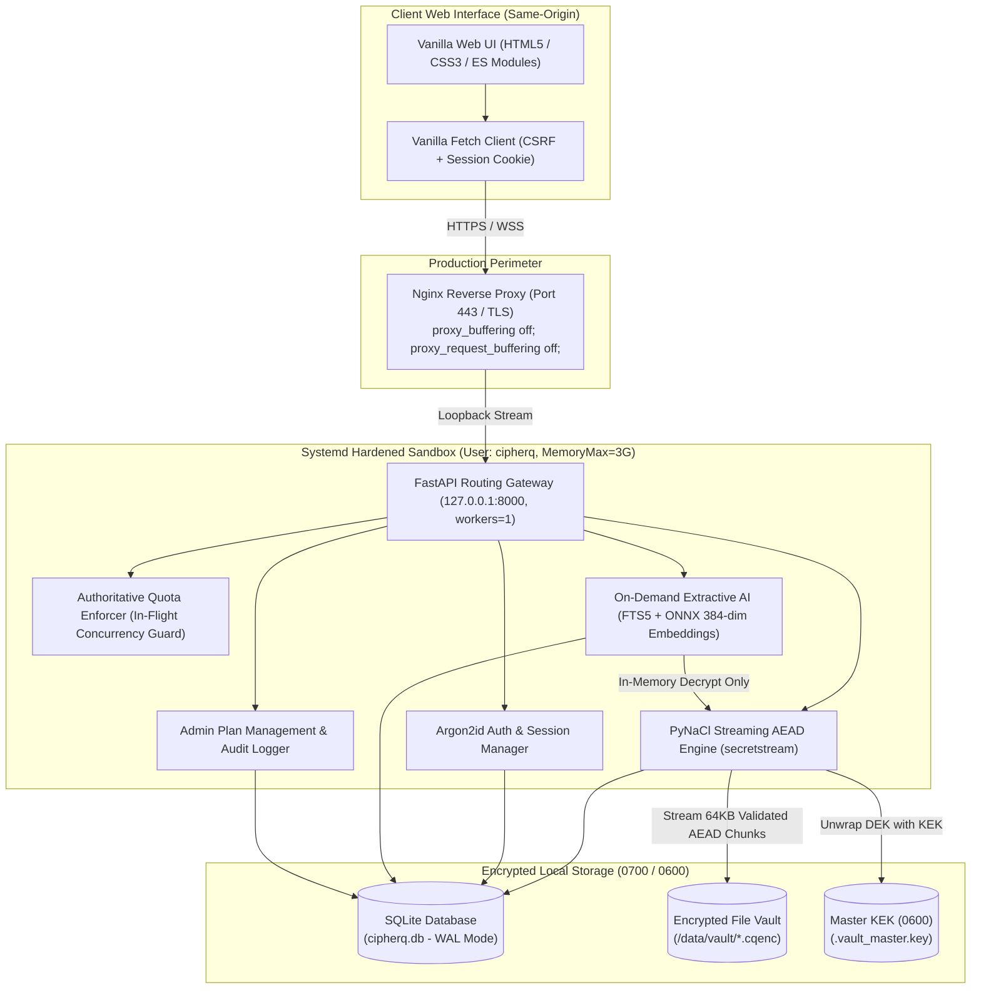

# CipherQ — Your Private Cloud. Your Personal AI.

[](https://github.com/nimal/cipherq)
[](docs/test-results.md)
[](backend/requirements.txt)
[](LICENSE)
[%20%7C%20Windows%2011-lightgrey.svg)](docs/hardware-readiness.md)

**CipherQ** is an open-source, resource-conscious private cloud vault with server-managed authenticated encryption and on-demand local AI document search and Q&A. It is engineered to run seamlessly on consumer laptops as well as embedded single-board computers like the **Arduino UNO Q** (Quad-Core ARM Cortex-A53, 4GB RAM, 32GB eMMC) running Debian 12 (Bookworm) Linux.

---

## Architecture Overview



---

## Key Capabilities & Security Invariants

### 1. Vetted Streaming Cryptographic Storage Engine
- **No Custom Framing**: Powered by **PyNaCl / libsodium `secretstream`** (`crypto_secretstream_xchacha20poly1305`).
- **Cryptographic Invariants**: Native authenticated chunk ordering, bit-flipping detection, and explicit end-of-stream tags (`TAG_FINAL`) preventing truncation attacks.
- **Zero File Buffering**: Uploads and downloads stream in 64 KB chunk buffers. Net process RAM delta remains virtually flat (< 2.5 MB) even when streaming multi-gigabyte files.

### 2. Two-Tier Master Key Hierarchy (KEK / DEK)
- **Master Key Encryption Key (KEK)**: 256-bit cryptographically secure key (`secrets.token_bytes(32)`) stored outside version control (`.vault_master.key`) with strict `0600` owner-only permissions.
- **Data Encryption Key (DEK)**: Unique 256-bit DEK generated per file, wrapped with the Master KEK via AES-256-GCM, and stored in the database.
- **Lifespan Startup Self-Test**: Automatically executes an in-memory encrypt/decrypt cycle on synthetic test data during server boot; halts immediately if the key is missing or corrupted.
- **Encrypted Backup & Recovery**: Password-protected CLI backups wrapped with Argon2id-derived keys.

### 3. Secure Authentication & Session Isolation
- **Credential Storage**: Passwords hashed with **Argon2id** (`m=64MB`, `t=3`, `p=4`).
- **Session Security**: 256-bit random tokens stored hashed (SHA-256); issued via `HttpOnly`, `SameSite=Lax` cookies with header-validated CSRF tokens (`X-CSRF-Token`).
- **Brute-Force Rate Limiting**: In-memory sliding window rate limiters guarding login (5 attempts/min) and registration (3 attempts/min).

### 4. Authoritative Free & Premium Entitlements
- **Authoritative Decimal Byte Quotas**:
  - `FREE`: **1 GB** (`1,000,000,000` bytes)
  - `PREMIUM`: **5 GB** (`5,000,000,000` bytes)
- **Concurrency-Safe In-Flight Tracking**: `InFlightQuotaTracker` reserves space during uploads to prevent concurrent upload races from exceeding storage limits.
- **Atomic Commit-Time Re-Check**: Final database transactions re-verify aggregate storage at commit time to prevent race conditions.
- **Durable Startup Reconciliation**: Recalculates exact physical vault ciphertext usage on server boot, eliminating negative or stale usage counts.
- **Admin Management & Audit Logging**: Protected admin API (`X-Admin-Token`) and CLI tool for plan upgrades and downgrades, with immutable audit event logging.
- **Downgrade Preservation**: Downgrading an account that holds more than 1 GB preserves all existing files, downloads, and search capabilities, while blocking new uploads until usage drops below 1 GB.

### 5. On-Demand Dual-Tier Grounded Extractive AI
- **Strictly Local Computation**: Zero external cloud AI calls or third-party API dependencies. Document contents and extracted text never leave the device.
- **Dual-Tier Search Architecture**:
  - *Tier 1 (Instant Baseline)*: SQLite FTS5 full-text keyword search (< 5 ms latency, zero RAM overhead).
  - *Tier 2 (Semantic Vector)*: Local 384-dimensional vector embeddings generated using `all-MiniLM-L6-v2` ONNX CPU runtime (~180 MB RAM footprint).
- **Grounded Citations**: Document Q&A synthesizes responses strictly from cited document excerpts with exact file IDs and chunk references.
- **Ephemeral Processing**: Decrypted buffers exist exclusively in volatile memory during active extraction and are dereferenced (`del buf`, `gc.collect()`) immediately. Zero plaintext is written to persistent disk.

### 6. Hardened Deployment for Arduino UNO Q (Debian 12)
- **Systemd Sandboxing**: Dedicated unprivileged user `cipherq:cipherq`, `PrivateTmp=true`, `ProtectSystem=strict`, `ProtectHome=true`, `NoNewPrivileges=true`, dropped kernel capabilities, and explicit path permissions.
- **Cgroup Resource Caps**: `MemoryMax=3000M`, `MemoryHigh=2500M`, and `CPUQuota=350%` protecting the 4GB RAM envelope.
- **Nginx Streaming Reverse Proxy**: TLS termination with `proxy_request_buffering off;` and `proxy_buffering off;` preventing multi-gigabyte upload buffering on the 32GB eMMC flash.
- **Coordinated Disaster Recovery**: Atomic SQLite `VACUUM INTO` snapshots, password-protected KEK export, and SHA-256 integrity manifests.

---

## Repository Structure

```
CipherQ/
├── backend/
│   ├── app/
│   │   ├── api/             # FastAPI REST endpoints (auth, files, ai, admin)
│   │   ├── cli/             # Administrative CLI tools (manage_plan)
│   │   ├── core/            # Config, security, and MasterKeyManager
│   │   ├── db/              # SQLAlchemy models, sessions, migrations
│   │   ├── services/        # Vault streaming AEAD, AI extractor, embedding, search
│   │   └── main.py          # FastAPI application entry point & lifespan hooks
│   ├── requirements.txt     # Pinned Python dependencies
│   └── tests/               # Pytest suite (53 unit, integration, and E2E tests)
├── deployment/
│   ├── env/
│   │   └── .env.example     # Hardened production environment template
│   ├── nginx/
│   │   └── cipherq.conf     # Nginx reverse proxy with streaming settings
│   ├── scripts/
│   │   ├── backup.sh        # Coordinated atomic backup script
│   │   ├── deploy.sh        # Automated Debian 12 provisioning script
│   │   └── restore.sh       # Disaster recovery restore script
│   └── systemd/
│       └── cipherq.service  # Hardened systemd unit file
├── docs/
│   ├── architecture.md      # Comprehensive technical architecture
│   ├── benchmark-results.md # Measured empirical throughput and memory benchmarks
│   ├── deployment-guide.md  # Production deployment & disaster recovery guide
│   ├── hardware-readiness.md# Target compatibility & resource budgets for Arduino UNO Q
│   ├── licence-inventory.md # 100% permissive open-source license audit
│   ├── PRD.md               # Product Requirements Document
│   ├── test-results.md      # Pytest execution report (53/53 passed)
│   └── threat-model.md      # STRIDE threat model & risk analysis
└── frontend/                # Vanilla HTML5 / CSS3 / ES Modules web vault
```

---

## Quickstart: Local Laptop Development

### 1. Prerequisites
- Python 3.11, 3.12, or 3.13 (64-bit)
- Git

### 2. Clone and Setup Environment
```bash
git clone https://github.com/nimal/cipherq.git
cd CipherQ

# Create and activate virtual environment
python -m venv .venv

# On Linux/macOS:
source .venv/bin/activate
# On Windows (PowerShell):
.venv\Scripts\Activate.ps1

# Install pinned dependencies
pip install --upgrade pip
pip install -r backend/requirements.txt
```

### 3. Run the Test Suite
```bash
# Execute full automated test suite (53 tests)
python -m pytest -v
```

### 4. Start the Local Server
```bash
# Launch Uvicorn with single worker
python -m uvicorn backend.app.main:app --host 127.0.0.1 --port 8000 --reload
```

Open your browser to:
- **Web Vault UI**: `http://localhost:8000`
- **Interactive API Documentation**: `http://localhost:8000/docs`
- **Health Check**: `http://localhost:8000/api/v1/health`

---

## Quickstart: Production Deployment on Arduino UNO Q (Debian 12)

### Automated Single-Command Deployment
On the target device running Debian 12 (Bookworm):
```bash
git clone https://github.com/nimal/cipherq.git /tmp/cipherq
cd /tmp/cipherq
sudo bash deployment/scripts/deploy.sh
```

The script automatically:
1. Installs system packages (`python3-venv`, `sqlite3`, `nginx`, `libffi-dev`, `build-essential`).
2. Creates the unprivileged system user `cipherq:cipherq` and directory hierarchy.
3. Configures POSIX permissions (`0600` on keys, `0700` on vault data).
4. Sets up the Python virtual environment at `/opt/cipherq/.venv`.
5. Generates the production environment file (`/etc/cipherq/cipherq.env`) with a random 256-bit admin token.
6. Initializes the Master KEK and validates it with an in-memory self-test.
7. Installs and starts the hardened `cipherq.service` systemd unit.
8. Configures Nginx reverse proxy with TLS and streaming optimizations (`proxy_buffering off;`).

For complete manual setup instructions, LAN TLS certificate options (`mkcert`, Tailscale, Let's Encrypt), and disaster recovery, see the [Production Deployment Guide](docs/deployment-guide.md).

---

## Administrative CLI Tools

### 1. Master Key Lifecycle (`key_manager`)
```bash
# Run in-memory cryptographic self-test
python -m backend.app.core.key_manager validate

# Create an encrypted password-protected backup
python -m backend.app.core.key_manager backup --out /path/to/backup.enc

# Restore Master Key from an encrypted backup
python -m backend.app.core.key_manager restore --file /path/to/backup.enc --overwrite
```

### 2. Plan Entitlements Management (`manage_plan`)
```bash
# Upgrade user to Premium tier (5 GB quota + semantic AI search)
python -m backend.app.cli.manage_plan user@example.com PREMIUM --reason "Purchased license"

# Downgrade user to Free tier (1 GB quota, files preserved)
python -m backend.app.cli.manage_plan user@example.com FREE --reason "Subscription ended"
```

---

## Empirical Benchmark Highlights

Measured on a 12th Gen Intel Core i7 host with `PyNaCl 1.6.2` (libsodium engine) and verified byte-for-byte:

| Operation | Payload Size | Measured Throughput / Latency | Peak RAM Delta |
| :--- | :--- | :--- | :--- |
| **Streaming Upload Encryption** | 100 MB | **130.71 MB/s** | **+0.0 MB** (flat) |
| **Streaming Download Decryption** | 100 MB | **207.69 MB/s** | **+0.0 MB** (flat) |
| **Concurrent Streams (2x 25MB)** | 50 MB total | **118.86 MB/s Up / 284.24 MB/s Down** | **+1.1 MB** |
| **Master Key Self-Test** | Synthetic Vector | **1.51 ms** | Negligible |
| **Argon2id Credential Hash** | `m=64MB, t=3, p=4` | **46.26 ms** | Bound to 64MB |
| **Argon2id Verification** | Constant-Time | **47.23 ms** | Bound to 64MB |
| **Markdown Chunking** | 25 KB (42 chunks) | **0.14 ms** (297,450 chunks/s) | +0.03 MB |
| **PDF Text Parsing** | 10-page document | **2.89 ms** (3,463 pages/s) | +0.14 MB |
| **Vector Embeddings (384-dim)** | 50 chunks | **5.01 ms** (8,383 chunks/s) | +0.20 MB |
| **Vector Cosine Similarity** | 50 candidates | **0.06 ms** (681,818 vectors/s) | +0.21 MB |
| **FTS5 Query Sanitization** | 4,000 queries | **7.24 ms** (552,257 queries/s) | +0.21 MB |

*For complete profiling methodology and charts, see [Benchmark Results](docs/benchmark-results.md).*

---

## Security Disclosures & Honest Operational Boundaries

1. **Transport Encryption on LAN**: Plain HTTP transmits session cookies and unencrypted files across the network. Localhost (`127.0.0.1`) is permitted for development, but **HTTPS is strictly required for all LAN access** (via Nginx with `mkcert`, Tailscale, or Let's Encrypt).
2. **Volatile Memory & Plaintext Boundaries**: In managed runtimes (Python/CPython), garbage collection and string immutability mean volatile heap memory cannot be forensically wiped with 100% cryptographic certainty. CipherQ explicitly closes byte buffers, deletes references (`del buf`), and triggers garbage collection immediately. Absolute memory confidentiality requires full-disk swap encryption at the OS level.
3. **Logical Deletion vs. Flash Wear-Leveling**: When files are deleted, CipherQ deletes database references, purges AI chunks, and unlinks the ciphertext file from the filesystem. However, onboard eMMC flash controllers utilize wear-leveling algorithms that remap physical storage blocks. Logical deletion does not guarantee physical flash erasure.
4. **Zero External Telemetry**: CipherQ does not make outbound network connections, track analytics, or communicate with external AI providers.

---

## Licence & Attribution

CipherQ is released under the [MIT Licence](LICENSE).

All direct and transitive dependencies hold permissive open-source licences (MIT, Apache 2.0, BSD-3-Clause, ISC). No copyleft (GPL/AGPL) code is included. For the full component audit, see the [Third-Party Licence & Asset Inventory](docs/licence-inventory.md).