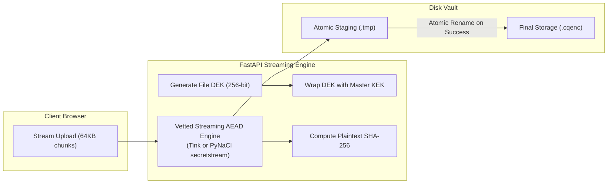

# CipherQ — Technical Architecture Specification

**Version**: 1.0.0-draft  
**Status**: Approved Specification  
**Target Hardware**: Arduino UNO Q (4GB RAM, 32GB eMMC, Debian Linux)  
**Development Baseline**: Local Laptop (FastAPI, Python 3.13, Vanilla HTML5/CSS3/JS)

---

## 1. System Topology & Serving Architecture

To eliminate CORS complexity, mixed-content blocking, and cookie partitioning during development and prototype demonstration, CipherQ implements a **Same-Origin Architecture**:

```
+-------------------------------------------------------------------------+
|                  Same-Origin Host (http://localhost:8000)                |
|                                                                         |
|  +--------------------------------+  +--------------------------------+ |
|  |       Static Web Frontend      |  |      FastAPI Backend Engine    | |
|  |  (Vanilla HTML5 / CSS3 / ESM)  |  |      (Python 3.13 / Uvicorn)   | |
|  |                                |  |                                | |
|  |  /                             |  |  /api/v1/auth/*                | |
|  |  /dashboard.html               |  |  /api/v1/files/*               | |
|  |  /files.html                   |  |  /api/v1/ai/*                  | |
|  |  /css/styles.css               |  |  /api/v1/usage/*               | |
|  |  /js/app.js                    |  |  /api/v1/health                | |
|  +--------------------------------+  +--------------------------------+ |
+-------------------------------------------------------------------------+
                                    |
                                    v
+-------------------------------------------------------------------------+
|                         Storage & Security Layer                        |
|                                                                         |
|  +---------------------+  +---------------------+  +-----------------+  |
|  | SQLite Database     |  | Encrypted Vault     |  | Master KEK      |  |
|  | (data/cipherq.db)   |  | (data/vault/*.cqenc)|  | (.vault_master) |  |
|  +---------------------+  +---------------------+  +-----------------+  |
+-------------------------------------------------------------------------+
```

### Network Security & LAN HTTPS Boundary
- **Localhost Development**: Running on `http://127.0.0.1:8000` or `http://localhost:8000` is permitted for local development because the browser treats `localhost` as a secure context.
- **LAN Access Warning**: Plain HTTP over a local network (`http://192.168.x.x:8000`) transmits session cookies and file chunks unencrypted over Wi-Fi/Ethernet.
- **Production LAN Deployment**: When running on the Arduino UNO Q accessible to home/office devices, one of the following TLS mechanisms is required:
  1. *Local Private PKI (`mkcert`)*: Installs a local trusted CA certificate on client browsers.
  2. *Split-Horizon DNS + Let's Encrypt*: Domain pointing to internal LAN IP with automated certificate renewal.
  3. *Encrypted Overlay Network*: Tailscale / WireGuard private network with automatic HTTPS.

---

## 2. Authentication & Session Security

- **Password Storage**: Passwords hashed with **Argon2id** (`argon2-cffi`), memory cost 64MB (`m_cost=65536`), time cost 3 (`t_cost=3`), parallelism 4 (`p_cost=4`).
- **Session Tokens**: 256-bit cryptographically secure random tokens generated via `secrets.token_urlsafe(32)`.
- **Session Transport**: Stored in a database-backed session table (hashed with SHA-256); issued to the browser via:
  - `HttpOnly`: Inaccessible to JavaScript (mitigates XSS).
  - `SameSite=Lax`: Defends against Cross-Site Request Forgery (CSRF).
  - `Secure`: Required in production when TLS is active.
- **CSRF Token**: Double-submit cookie or custom header `X-CSRF-Token` validated against active session on all mutating HTTP methods (`POST`, `PUT`, `PATCH`, `DELETE`).

---

## 3. Master Key Lifecycle (Option B - Server-Managed Vault)

CipherQ uses a two-tier key hierarchy:
1. **Master Key Encryption Key (KEK)**: 256-bit AES key.
2. **Data Encryption Key (DEK)**: 256-bit random key generated uniquely per file.

### Key Management Rules:
1. **Storage Outside Repository**: Stored in `.vault_master.key` in the project root, strictly excluded in `.gitignore`.
2. **File Permissions**: Must have owner-only permissions (`0600` on POSIX systems; restricted DACL on Windows). Backend startup aborts immediately if permissions are overly permissive.
3. **Startup Validation Self-Test**: During FastAPI startup lifespan, the server:
   - Verifies the file exists and is strictly 32 bytes (256 bits).
   - Validates file permissions.
   - Executes an in-memory encrypt/decrypt cycle on synthetic test data.
   - If any check fails, server logs an emergency alert and exits.
4. **Encrypted Backup & Recovery**:
   - `python -m app.core.key_manager backup`: Prompts for an administrator passphrase, derives a key via Argon2id, and exports an authenticated AES-256-GCM backup container (`cipherq_kek_backup.enc`).
   - `python -m app.core.key_manager restore <path>`: Prompts for the passphrase, verifies the authentication tag, and restores `.vault_master.key`.
   - *Limitation Disclosure*: If `.vault_master.key` is lost without a backup, all encrypted files in the vault are permanently unrecoverable.

---

## 4. Cryptographic Storage Engine: Vetted Streaming AEAD

CipherQ strictly prohibits custom cryptographic framing. The storage engine evaluates two vetted streaming AEAD constructions:



### Comparison Matrix: Google Tink vs. PyNaCl / libsodium

| Evaluation Dimension | Google Tink `StreamingAead` | PyNaCl / libsodium `secretstream` |
| :--- | :--- | :--- |
| **Tested Version** | `tink 1.16.1` (Python 3.13) | `pynacl 1.6.2` (Python 3.13) |
| **Cryptographic Scheme** | AES-256-GCM-HKDF (`AES256_GCM_HKDF_4KB`) | XChaCha20-Poly1305 state machine |
| **Licence** | Apache 2.0 | ISC License (libsodium) / Apache 2.0 (PyNaCl) |
| **Framing Specification** | Audited Tink segment framing | Audited libsodium `crypto_secretstream` format |
| **Reorder & Truncation Resistance** | Native: segment tags & chunk counters | Native: `TAG_FINAL` / sequential state |
| **Python API** | Native `io.RawIOBase` file stream objects | CFFI state machine (`push` / `pull` blocks) |
| **Platform Compatibility** | x86_64 and aarch64 binary wheels; potential armv7l build requirement | Standard C libsodium; supported across virtually all Linux architectures |

---

## 5. Deletion & Cleanup Architecture: Durable & Conservative

To avoid distributed state corruption across SQLite and the filesystem, CipherQ implements a **Durable, Retryable Cleanup Workflow**:

### Two-Phase Deletion Flow
1. **User Request**: User sends `DELETE /api/v1/files/{file_id}`.
2. **Phase 1 (Database Soft-Delete)**:
   - File status updated to `PENDING_DELETION`.
   - File immediately disappears from user listings and API queries.
   - Deletion task inserted into SQLite `cleanup_queue` table (`status='PENDING'`).
3. **Phase 2 (Asynchronous / Immediate Purge)**:
   - Worker unlinks `{file_id}.cqenc` from disk via `os.remove`.
   - Worker purges all AI chunks, embeddings, and FTS5 rows linked to `file_id`.
   - Worker marks task as `COMPLETED` and purges the file record from `files`.

### Conservative Startup Reconciliation
On server startup, a background reconciliation routine runs:
1. **Active Upload Safety**: Temporary upload staging files (`*.tmp`) modified within the last **30 minutes** are strictly preserved. This prevents server restarts from aborting active client uploads.
2. **Stale Temp Cleanup**: Only `.tmp` files older than 1 hour with no active session are unlinked.
3. **Orphan Storage Quarantine**: Files on disk with no matching record in the database are moved to `vault/orphans/` with a logged warning, preventing accidental data loss.
4. **Retryable Deletions**: Any job in `cleanup_queue` with `status IN ('PENDING', 'FAILED')` is resumed and retried.

---

## 6. AI Data Lifecycle: Ephemeral vs. Persistent

```
+--------------------------------------------------------------------------+
|                        Ephemeral In-Memory Processing                    |
|                                                                          |
|  [Decrypted Stream] ---> [Raw PDF/Text] ---> [Tokens] ---> [Activations] |
|                                                                          |
|  * Strictly in volatile RAM during active indexing request               |
|  * Buffers explicitly closed and dereferenced ('del buf', 'gc.collect()')|
|  * ZERO intermediate plaintext files written to persistent disk          |
+--------------------------------------------------------------------------+
                                     |
                         Extract & Embeddings Chunks
                                     v
+--------------------------------------------------------------------------+
|                         Persistent AI-Derived Data                       |
|                                                                          |
|  SQLite Database:                                                        |
|  - ai_chunks table (chunk text, token count, file_id FK)                 |
|  - fts5_document_chunks (keyword search index)                           |
|  - vector_embeddings (float arrays for semantic similarity)              |
|                                                                          |
|  * Purged durably via cleanup_queue upon file deletion                   |
+--------------------------------------------------------------------------+
```

---

## 7. Database Schema (SQLite)

```sql
-- Users Table
CREATE TABLE users (
    id TEXT PRIMARY KEY,
    email TEXT UNIQUE NOT NULL,
    hashed_password TEXT NOT NULL,
    plan_type TEXT NOT NULL DEFAULT 'FREE', -- 'FREE' or 'PREMIUM'
    is_active INTEGER NOT NULL DEFAULT 1,
    created_at TIMESTAMP DEFAULT CURRENT_TIMESTAMP
);

-- Sessions Table
CREATE TABLE sessions (
    token_hash TEXT PRIMARY KEY,
    user_id TEXT NOT NULL REFERENCES users(id) ON DELETE CASCADE,
    csrf_token TEXT NOT NULL,
    expires_at TIMESTAMP NOT NULL,
    created_at TIMESTAMP DEFAULT CURRENT_TIMESTAMP
);

-- File Vault Metadata
CREATE TABLE files (
    id TEXT PRIMARY KEY,
    user_id TEXT NOT NULL REFERENCES users(id) ON DELETE CASCADE,
    original_name TEXT NOT NULL,
    storage_name TEXT NOT NULL UNIQUE,
    file_size_bytes INTEGER NOT NULL,
    mime_type TEXT NOT NULL,
    sha256_hash TEXT NOT NULL,
    wrapped_dek BLOB NOT NULL,
    nonce_or_header BLOB NOT NULL,
    status TEXT NOT NULL DEFAULT 'ACTIVE', -- 'ACTIVE', 'PENDING_DELETION'
    is_indexed INTEGER NOT NULL DEFAULT 0,
    created_at TIMESTAMP DEFAULT CURRENT_TIMESTAMP
);

-- Durable Cleanup Queue
CREATE TABLE cleanup_queue (
    task_id TEXT PRIMARY KEY,
    file_id TEXT NOT NULL,
    storage_path TEXT NOT NULL,
    status TEXT NOT NULL DEFAULT 'PENDING', -- 'PENDING', 'IN_PROGRESS', 'FAILED', 'COMPLETED'
    retry_count INTEGER NOT NULL DEFAULT 0,
    last_error TEXT,
    created_at TIMESTAMP DEFAULT CURRENT_TIMESTAMP,
    updated_at TIMESTAMP DEFAULT CURRENT_TIMESTAMP
);

-- AI Chunks Table
CREATE TABLE ai_chunks (
    id TEXT PRIMARY KEY,
    file_id TEXT NOT NULL REFERENCES files(id) ON DELETE CASCADE,
    user_id TEXT NOT NULL REFERENCES users(id) ON DELETE CASCADE,
    chunk_index INTEGER NOT NULL,
    content TEXT NOT NULL,
    token_count INTEGER NOT NULL,
    created_at TIMESTAMP DEFAULT CURRENT_TIMESTAMP
);

-- Storage & AI Usage Records
CREATE TABLE usage_records (
    user_id TEXT PRIMARY KEY REFERENCES users(id) ON DELETE CASCADE,
    storage_bytes_used INTEGER NOT NULL DEFAULT 0,
    ai_queries_today INTEGER NOT NULL DEFAULT 0,
    last_query_date TEXT
);
```
