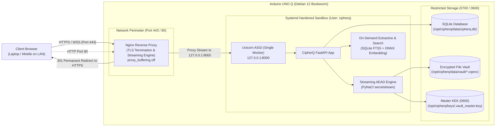

# CipherQ — Arduino UNO Q Production Deployment Guide

> **Scope and safety:** This guide is for a fresh backend installation or an
> explicitly approved maintenance window. It is not required to deploy the
> static frontend to GitHub Pages. If an Arduino UNO Q already has a working
> FastAPI service, encrypted vault, authentication, and local AI, do not run
> the provisioning, restart, restore, or configuration commands in this guide
> without separate backup and change approval.

The frontend deployment is documented separately in
[`github-pages-frontend.md`](github-pages-frontend.md). GitHub Pages publishes
only static files and cannot make a private Arduino backend publicly reachable.
Remote access requires a separately configured HTTPS endpoint and restricted
outbound tunnel.

## 1. Overview and Architecture

This guide covers the deployment of **CipherQ** on Debian 12 (Bookworm) Linux, targeting the **Arduino UNO Q** single-board computer (Quad-Core ARM Cortex-A53, 4GB RAM, 32GB eMMC).

The production architecture enforces defense-in-depth across the operating system, network, and application layers:



### Architectural Tenets
1. **Strict Loopback Binding**: FastAPI/Uvicorn binds strictly to `127.0.0.1:8000`. It is never bound to `0.0.0.0` or exposed unencrypted over the local network.
2. **Reverse Proxy Streaming**: Nginx terminates TLS and proxies chunked requests with `proxy_request_buffering off;` and `proxy_buffering off;`. Uploads stream directly into the PyNaCl encryption engine, preventing multi-gigabyte disk spooling on the 32GB eMMC flash.
3. **Single-Worker Concurrency (`workers=1`)**: Guarantees in-memory in-flight quota reservations and concurrency locks operate safely without requiring an external distributed coordination daemon (e.g. Redis).
4. **Least-Privilege Isolation**: Runs under a dedicated system account (`cipherq`) within a locked-down systemd sandbox (`ProtectSystem=strict`, `ProtectHome=true`, `PrivateTmp=true`, dropped capabilities).
5. **Zero External Phone-Home**: Completely self-contained; no telemetry, metrics collection, or cloud AI services.

---

## 2. Prerequisites

- **Hardware**: Arduino UNO Q (or compatible Debian aarch64 / x86_64 host) with at least 2GB free storage on eMMC/microSD and 4GB RAM.
- **Operating System**: Debian 12 (Bookworm) minimal installation with administrative (`sudo`) access.
- **Networking**: Static LAN IP or local DNS name (e.g., `cipherq.local` via mDNS/Avahi).
- **Network Ports**:
  - Port 80 (HTTP redirect to HTTPS)
  - Port 443 (HTTPS production web vault and API)
  - Port 22 (SSH administrative access)

---

## 3. Automated Quickstart Deployment

CipherQ provides an automated provisioning script that installs dependencies, creates service accounts, applies permissions, sets up systemd, and configures Nginx:

```bash
# 1. Clone repository to temporary staging
git clone https://github.com/nimalan-parameswaran/CipherQ.git /tmp/cipherq
cd /tmp/cipherq

# 2. Run automated installer with root privileges
sudo bash deployment/scripts/deploy.sh
```

The script executes 8 automated phases:
1. Environment and architecture detection (`aarch64` / `x86_64`).
2. Package installation (`python3-venv`, `sqlite3`, `nginx`, `libffi-dev`, `build-essential`).
3. Dedicated `cipherq` service user and directory provisioning (`/opt/cipherq`).
4. Python virtual environment setup and wheel installation.
5. Production configuration generation (`/etc/cipherq/cipherq.env`) with secure `ADMIN_TOKEN`.
6. Master Key generation and startup self-test.
7. Systemd service registration and start (`cipherq.service`).
8. Nginx reverse proxy installation and TLS bootstrap certificate generation.

---

## 4. Manual Step-by-Step Installation

If customizing directory paths or integrating with an existing configuration management system (Ansible, Puppet):

### Step 1: Install System Dependencies
```bash
sudo apt-get update
sudo apt-get install -y --no-install-recommends \
    python3 python3-venv python3-pip python3-dev \
    sqlite3 nginx curl openssl libffi-dev libssl-dev build-essential
```

### Step 2: Create Service User and Directory Hierarchy
```bash
# Create unprivileged system user
sudo useradd -r -s /usr/sbin/nologin -d /opt/cipherq -c "CipherQ Vault Daemon" cipherq

# Create directories
sudo mkdir -p /opt/cipherq/data/vault/orphans
sudo mkdir -p /opt/cipherq/keys
sudo mkdir -p /opt/cipherq/backups
sudo mkdir -p /etc/cipherq
sudo mkdir -p /var/log/cipherq

# Enforce least-privilege POSIX permissions
sudo chmod 750 /opt/cipherq
sudo chmod 700 /opt/cipherq/data /opt/cipherq/data/vault /opt/cipherq/data/vault/orphans
sudo chmod 700 /opt/cipherq/keys /opt/cipherq/backups
sudo chmod 750 /etc/cipherq
sudo chmod 755 /var/log/cipherq

sudo chown -R cipherq:cipherq /opt/cipherq /etc/cipherq /var/log/cipherq
```

### Step 3: Install Application Code and Python Virtualenv
```bash
# Copy backend and frontend code to /opt/cipherq
sudo cp -r backend frontend /opt/cipherq/

# Create virtual environment and install dependencies
sudo python3 -m venv /opt/cipherq/.venv
sudo /opt/cipherq/.venv/bin/pip install --upgrade pip setuptools wheel
sudo /opt/cipherq/.venv/bin/pip install -r /opt/cipherq/backend/requirements.txt

sudo chown -R cipherq:cipherq /opt/cipherq
```

### Step 4: Configure Production Environment
```bash
# Copy environment template
sudo cp deployment/env/.env.example /etc/cipherq/cipherq.env

# Generate secure random admin token (32 bytes = 64 hex characters)
ADMIN_SECRET="$(openssl rand -hex 32)"
sudo sed -i "s/REPLACE_WITH_SECURE_RANDOM_HEX_64_CHARS/${ADMIN_SECRET}/" /etc/cipherq/cipherq.env

# Enforce strict 0600 permissions (readable ONLY by cipherq service)
sudo chmod 600 /etc/cipherq/cipherq.env
sudo chown cipherq:cipherq /etc/cipherq/cipherq.env
```

### Step 5: Initialize Master Key Encryption Key (KEK)
```bash
# Initialize 256-bit Master Key as user cipherq
sudo -u cipherq /opt/cipherq/.venv/bin/python3 -m backend.app.core.key_manager generate

# Verify 0600 file permissions
sudo chmod 600 /opt/cipherq/keys/.vault_master.key

# Execute in-memory cryptographic self-test
sudo -u cipherq /opt/cipherq/.venv/bin/python3 -m backend.app.core.key_manager validate
```

### Step 6: Install and Enable Systemd Service
```bash
sudo cp deployment/systemd/cipherq.service /etc/systemd/system/cipherq.service
sudo systemctl daemon-reload
sudo systemctl enable --now cipherq.service

# Check service status
sudo systemctl status cipherq.service
```

---

## 5. TLS / HTTPS Certificate Management for LAN Access

> [!WARNING]
> **Transport Encryption Requirement**:
> Accessing CipherQ over a local network using plain HTTP transmits user passwords, session tokens, and unencrypted file payloads in cleartext across the local network. **HTTPS is mandatory for all non-localhost access.**

### Option A: Local CA with `mkcert` (Recommended for Home / Office LAN)
`mkcert` creates a locally trusted CA and installs it in your client devices' trust stores:
```bash
# On your admin laptop:
mkcert -install
mkcert cipherq.local 192.168.1.150 localhost 127.0.0.1

# Copy generated certificates to the Arduino UNO Q:
scp cipherq.local+3.pem root@cipherq.local:/etc/ssl/certs/cipherq.crt
scp cipherq.local+3-key.pem root@cipherq.local:/etc/ssl/private/cipherq.key

# Enforce private key permissions on the device:
ssh root@cipherq.local "chmod 600 /etc/ssl/private/cipherq.key && systemctl restart nginx"
```

### Option B: Tailscale MagicDNS (Recommended for Encrypted Remote Access)
If using [Tailscale](https://tailscale.com) for mesh networking:
```bash
# Generate valid TLS certificates from Let's Encrypt automatically via Tailscale
sudo tailscale cert cipherq-node.your-tailnet.ts.net

# Link to Nginx paths
sudo ln -sf /root/cipherq-node.your-tailnet.ts.net.crt /etc/ssl/certs/cipherq.crt
sudo ln -sf /root/cipherq-node.your-tailnet.ts.net.key /etc/ssl/private/cipherq.key
sudo systemctl restart nginx
```

### Option C: Public Domain with Let's Encrypt / Certbot
If the Arduino UNO Q has a public DNS domain pointed to it:
```bash
sudo apt-get install -y certbot python3-certbot-nginx
sudo certbot --nginx -d vault.yourdomain.com
```

---

## 6. Coordinated Backup & Disaster Recovery Runbook

CipherQ includes coordinated, skew-resistant backup and restore scripts.

### Creating an Atomic Backup
The backup script performs three atomic operations:
1. Snapshots SQLite database using transactionally consistent `sqlite3 "VACUUM INTO '...'"` (no locks, zero corruption).
2. Exports the Master KEK into a password-protected Argon2id-wrapped container (`cipherq_kek_backup.enc`).
3. Bundles encrypted vault files (`*.cqenc`) with a `manifest.sha256` checksum file.

```bash
# Interactive backup (prompts for backup passphrase):
sudo bash /opt/cipherq/deployment/scripts/backup.sh /opt/cipherq/backups

# Automated backup via environment variable (e.g. nightly cron job):
export CIPHERQ_BACKUP_PASSPHRASE="YourSuperSecureBackupPassword2026!"
sudo -E bash /opt/cipherq/deployment/scripts/backup.sh /opt/cipherq/backups
```

To schedule nightly automated backups at 03:00 AM, add to `/etc/crontab`:
```cron
0 3 * * * root CIPHERQ_BACKUP_PASSPHRASE="YourSuperSecureBackupPassword2026!" bash /opt/cipherq/deployment/scripts/backup.sh /mnt/external_backup_drive/cipherq >> /var/log/cipherq/backup.log 2>&1
```

### Performing Disaster Recovery / Restoration
To restore a system from a backup archive:
```bash
# Syntax: sudo bash deployment/scripts/restore.sh <backup-archive.tar.gz>
sudo bash /opt/cipherq/deployment/scripts/restore.sh /opt/cipherq/backups/cipherq_backup_20261017_200000.tar.gz
```
The restore script will:
1. Verify SHA-256 checksums of all archive contents against `manifest.sha256`.
2. Stop `cipherq.service` to prevent state drift.
3. Prompt for the KEK backup passphrase and restore `.vault_master.key` with `0600` permissions.
4. Restore `cipherq.db` and `.cqenc` vault files.
5. Restart `cipherq.service` and execute startup vault reconciliation.

---

## 7. Operational Rollback Procedures

If an upgrade, dependency update, or database restore fails:

### Step 1: Halt Service Activity
```bash
sudo systemctl stop cipherq.service
```

### Step 2: Restore Previous Codebase and Virtual Environment
If code updates or package dependencies failed:
```bash
# If a pre-upgrade backup snapshot directory was created (/opt/cipherq.prev):
sudo rm -rf /opt/cipherq/backend /opt/cipherq/frontend /opt/cipherq/.venv
sudo cp -r /opt/cipherq.prev/backend /opt/cipherq/
sudo cp -r /opt/cipherq.prev/frontend /opt/cipherq/
sudo cp -r /opt/cipherq.prev/.venv /opt/cipherq/
```

### Step 3: Rollback Database and Master KEK
```bash
# Restore previous known-good database snapshot
sudo cp /opt/cipherq/backups/latest_good_db.sqlite /opt/cipherq/data/cipherq.db
sudo chmod 600 /opt/cipherq/data/cipherq.db
sudo chown cipherq:cipherq /opt/cipherq/data/cipherq.db

# If KEK was modified, restore backup key:
sudo -u cipherq /opt/cipherq/.venv/bin/python3 -m backend.app.core.key_manager restore --file /opt/cipherq/backups/cipherq_kek_backup.enc --overwrite
```

### Step 4: Validate and Restart
```bash
# Verify Master Key self-test passes
sudo -u cipherq /opt/cipherq/.venv/bin/python3 -m backend.app.core.key_manager validate

# Restart daemon and verify health
sudo systemctl start cipherq.service
curl -s http://127.0.0.1:8000/api/v1/health
```

---

## 8. Host Storage Safety Limit & Headroom Protection

The Arduino UNO Q's 32GB onboard eMMC is a shared resource between the Linux operating system, package updates, systemd journal logs, SQLite WAL files, and encrypted `.cqenc` vault files.

### Global Storage Protection Mechanism
- Per-user quotas (1 GB Free / 5 GB Premium) protect against individual abuse, but do not prevent aggregate disk exhaustion when multiple users store files.
- CipherQ enforces a **Global Host Disk Headroom Safety Limit** via `settings.MIN_FREE_DISK_BYTES` (default: **1,000,000,000 bytes / 1 GB**).
- **Behavior under Storage Pressure**:
  - Before writing in-flight uploads and while streaming chunks, `InFlightQuotaTracker` checks actual physical filesystem free space via `shutil.disk_usage`.
  - If available disk headroom minus active in-flight transfers drops below `MIN_FREE_DISK_BYTES`, new uploads are rejected or paused with **`HTTP 507 Insufficient Storage`**.
  - This ensures the device never runs out of disk space, preventing flash write stalls, SQLite database corruption, and systemd journal failure.

---

## 9. Service Operations, Monitoring, and Health Checks

### Check Service Status
```bash
sudo systemctl status cipherq.service
```

### Inspect Live Logs
```bash
# Real-time application logs
sudo journalctl -u cipherq.service -f

# Real-time Nginx web server logs
sudo tail -f /var/log/nginx/cipherq_access.log /var/log/nginx/cipherq_error.log
```

### Inspect System Memory & Cgroup Consumption
```bash
systemd-cgtop
```

### Query Application Health Endpoint
```bash
curl -k https://localhost/api/v1/health
# Expected JSON Response:
# {"status":"healthy","project":"CipherQ","version":"1.0.0-rc1","master_key_configured":true}
```

---

## 10. Operational Troubleshooting

| Symptom | Root Cause | Solution |
| :--- | :--- | :--- |
| **`502 Bad Gateway` on Nginx** | Uvicorn is not running or crashed on startup. | Inspect `sudo journalctl -u cipherq.service -n 50`. Check for permission errors on `.vault_master.key` or missing dependencies in `.venv`. |
| **`Insecure permissions on .vault_master.key`** | Key file permissions are wider than `0600`. | Run `sudo chmod 600 /opt/cipherq/keys/.vault_master.key && sudo chown cipherq:cipherq /opt/cipherq/keys/.vault_master.key`. |
| **`HTTP 507 Insufficient Storage`** | Host storage has reached safety margin (`MIN_FREE_DISK_BYTES`). | Clean up old backups in `/opt/cipherq/backups/`, rotate systemd logs (`journalctl --vacuum-size=200M`), or mount an external drive for `/opt/cipherq/data/vault`. |
| **`HTTP 413 Payload Too Large`** | Nginx `client_max_body_size` exceeded or user quota exceeded. | Verify `deployment/nginx/cipherq.conf` contains `client_max_body_size 5000M;`. For user quota, upgrade user plan or delete files. |
| **Uploads stall or cause high flash wear** | Nginx request buffering is enabled. | Ensure `proxy_request_buffering off;` and `proxy_buffering off;` are declared in `location /` of the Nginx configuration. |
| **Service killed with `SIGKILL` (Status 9)** | Systemd `MemoryMax=3000M` exceeded. | Check whether an unverified generative LLM was enabled. Ensure only the lightweight ONNX embedding engine is active. |
