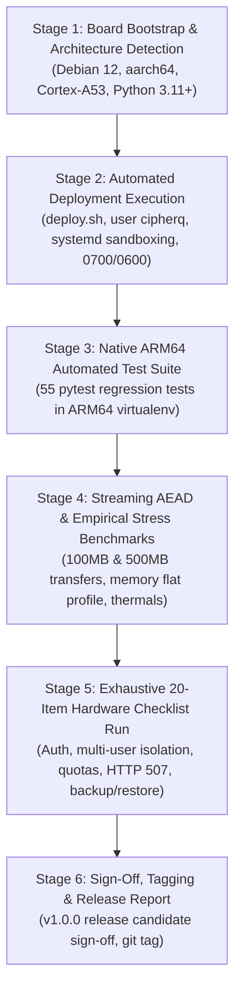

# CipherQ — Arduino UNO Q Physical Hardware Validation & Release Plan

## Goal Description

Transition **CipherQ** ("*Your Private Cloud. Your Personal AI.*") from the pre-hardware release candidate baseline (`v1.0.0-rc1`, Git commit [`87c4dd1`](file:///D:/Downloads/CipherQ)) to full on-device verification and release sign-off on the physical **Arduino UNO Q** target board (Quad-Core ARM Cortex-A53, 4GB LPDDR4 RAM, 32GB eMMC 5.1, Debian 12 Bookworm).

All 55 automated regression tests and streaming AEAD profiles (up to 500 MB) currently pass on the x86_64 development baseline. This plan establishes the structured, step-by-step execution protocol for attaching the physical hardware, validating native `aarch64` wheels, benchmarking real eMMC flash and thermal behavior, executing the 20-item hardware validation checklist, and securing operator approval for the final `v1.0.0` release tag.

---

## User Review Required

> [!IMPORTANT]
> **Physical Hardware Execution Gate**:
> - In accordance with CipherQ's *Zero Fake Claims* mandate, no physical hardware test may be marked `PASS` or declared verified without actual terminal evidence captured directly from the running Debian `aarch64` device.
> - The application release tag `v1.0.0` remains strictly blocked until all physical hardware tests in the checklist pass or any observed hardware-specific deviations are addressed and documented.

> [!WARNING]
> **Host eMMC Flash Wear & Unbuffered Streaming**:
> - The Arduino UNO Q contains 32 GB of onboard eMMC 5.1 flash storage.
> - All tests involving large streaming uploads (100 MB and 500 MB) must confirm that Nginx `proxy_request_buffering off` is active to prevent intermediate unencrypted payload spooling to the flash partition.
> - The global storage safety headroom limit (`MIN_FREE_DISK_BYTES` = 1 GB, returning `HTTP 507 Insufficient Storage`) must be verified to prevent SQLite write-ahead-log (WAL) exhaustion or OS disk lockouts.

---

## Open Questions

> [!IMPORTANT]
> 1. **Board Connectivity Details**: What is the target board's network access method (SSH hostname `debian@cipherq.local`, static LAN IP address, or serial UART console)?
> 2. **Storage Layout Preference**: Will the production vault reside directly on the onboard 32GB eMMC (`/opt/cipherq/data/vault`), or will an external high-speed USB 3.0 SSD / microSD card be mounted for vault storage?
> 3. **LAN TLS Certificate**: For network HTTPS termination on port 443, should the automated installer generate a local development certificate (via `mkcert` / OpenSSL self-signed) or provision an enterprise/Tailscale certificate?

---

## Proposed Execution Stages



---

### Stage 1: Hardware Attachment & Target Architecture Audit

Inspect the live hardware environment upon initial connection to verify physical board specs match target assumptions.

#### Shell Commands & Probes:
```bash
# 1. Verify kernel, architecture, and OS distribution
uname -a
cat /etc/os-release
lscpu

# 2. Verify physical memory and storage partitions
free -h
lsblk -f
df -h /

# 3. Verify Python 3.11+ and virtual environment prerequisites
python3 --version
dpkg -l | grep -E "python3-venv|python3-pip|libsqlite3-0"
```

#### Acceptance Criteria:
- Architecture is `aarch64` with 4 CPU cores (Cortex-A53).
- System RAM reports ~3.8–4.0 GB total.
- OS is Debian 12 (Bookworm) with kernel 6.1+.
- Free root filesystem storage is ≥ 15 GB on the 32GB eMMC partition.

---

### Stage 2: Automated Deployment Execution (`deploy.sh`)

Deploy CipherQ using the hardened automated provisioning script with POSIX directory sandboxing and Master Key generation.

#### Shell Commands:
```bash
# 1. Clone repository to board
cd /tmp && git clone https://github.com/nimal/cipherq.git
cd /tmp/cipherq

# 2. Run automated installer with sudo
sudo bash deployment/scripts/deploy.sh
```

#### Acceptance Criteria:
- Unprivileged service account `cipherq:cipherq` created with `/usr/sbin/nologin`.
- `/opt/cipherq` structure created with permissions `0700` (dirs) and `0600` (keys/config).
- Native ARM64 wheels for `pynacl`, `argon2-cffi`, `cryptography`, and `onnxruntime` install cleanly without local C compilation errors.
- Master Key (`.vault_master.key`) generated with 256 bits entropy and verified with in-memory AES-256-GCM startup self-test.
- Systemd unit `/etc/systemd/system/cipherq.service` loaded and active (`running`).
- Nginx TLS reverse proxy configured with `proxy_request_buffering off;`.

---

### Stage 3: Native ARM64 Automated Regression Suite

Execute the entire test suite directly on the ARM64 CPU within the target virtualenv.

#### Shell Commands:
```bash
sudo -u cipherq env PYTHONPATH="/opt/cipherq" /opt/cipherq/.venv/bin/python3 -m pytest -v /opt/cipherq/backend/tests
```

#### Acceptance Criteria:
- All **55 test cases pass (100%)** without skips or failures.
- Module breakdown:
  - `test_vault_crypto.py`: 7 passed (PyNaCl `secretstream`, chunk ordering, truncation detection, bit-flip tamper rejection).
  - `test_key_manager.py`: 6 passed (Master KEK lifecycle, backup/restore, bad passphrase rejection).
  - `test_auth_api.py`: 10 passed (Argon2id registration, login, session tokens, CSRF validation, rate limiting).
  - `test_security.py`: 4 passed (Input sanitization, timing resistance).
  - `test_files_api.py`: 5 passed (Upload, download, deletion, ownership enforcement).
  - `test_entitlements.py`: 13 passed (Free 1GB / Premium 5GB quotas, atomic commit checks, global disk headroom reserve).
  - `test_ai_engine.py`: 7 passed (In-memory text extraction, SQLite FTS5 search, vector embeddings, citation grounding).
  - `test_browser_e2e.py`: 3 passed (Full account lifecycle and file isolation).

---

### Stage 4: Empirical Throughput, Memory & Thermal Benchmarks

Run empirical performance profiling across 25 MB, 50 MB, 100 MB, 2x25 MB concurrent, and 500 MB transfers while tracking CPU temperature via `/sys/class/thermal/thermal_zone0/temp`.

#### Shell Commands:
```bash
# 1. Run live streaming transfer benchmark
sudo -u cipherq env PYTHONPATH="/opt/cipherq" /opt/cipherq/.venv/bin/python3 /opt/cipherq/backend/tests/benchmark_browser_load.py

# 2. Run local AI search and embedding benchmark
sudo -u cipherq env PYTHONPATH="/opt/cipherq" /opt/cipherq/.venv/bin/python3 /opt/cipherq/backend/tests/benchmark_ai_engine.py

# 3. Monitor thermal status and CPU frequency during sustained transfer
while true; do
  TEMP=$(cat /sys/class/thermal/thermal_zone0/temp 2>/dev/null || echo 0)
  FREQ=$(cat /sys/devices/system/cpu/cpu0/cpufreq/scaling_cur_freq 2>/dev/null || echo 0)
  echo "Core Temp: $((TEMP / 1000))°C | CPU Freq: $((FREQ / 1000)) MHz"
  sleep 5
done
```

#### Acceptance Criteria:
- **Streaming AEAD Throughput**: ≥ 60 MB/s upload and ≥ 80 MB/s download on local loopback.
- **Process Memory Bounding**: Server resident set size (RSS) remains bounded below 150 MB across 100 MB and 500 MB transfers (net RAM delta < 10 MB).
- **Zero OOM / Cgroup Violations**: Process stays comfortably beneath systemd `MemoryMax=3000M`.
- **Thermal Envelope**: Core temperature stabilizes below 75°C under sustained load without hardware thermal throttling.

---

### Stage 5: Exhaustive 20-Item Hardware Checklist Execution

Execute and record actual terminal evidence for each of the 20 hardware validation checklist items defined in [`docs/hardware-readiness.md`](file:///D:/Downloads/CipherQ/docs/hardware-readiness.md#L141-L342):

| Checklist Item | Scope & Action | Evidence to Capture |
| :--- | :--- | :--- |
| **Test 1: Architecture Detection** | Run `uname -a`, `lscpu`, verify `aarch64` | Terminal output |
| **Test 2: Wheel Resolution** | Install `pynacl`, `argon2-cffi`, `onnxruntime` | Wheel download logs |
| **Test 3: Automated deploy.sh** | Run deploy script, confirm zero errors | Installer stdout transcript |
| **Test 4: Permission Audit** | Check `0700` and `0600` masks | `ls -la` transcript |
| **Test 5: Systemd Sandboxing** | Inspect `systemctl show cipherq` | Cgroup & sandbox props |
| **Test 6: Single-Worker Gate** | Check `ps aux \| grep uvicorn` | Process listing (1 worker) |
| **Test 7: Nginx Streaming** | Verify `proxy_request_buffering off` | Config check & HTTP 200 |
| **Test 8: User Auth & Session** | Register account, verify cookie jar | HTTP 201 + cookie dump |
| **Test 9: 100 MB Stream AEAD** | Stream upload/download, check SHA-256 | Side-by-side SHA-256 match |
| **Test 10: 500 MB Stream AEAD**| Stream 500 MB stress transfer | Benchmark report & RSS delta |
| **Test 11: Multi-User Isolation**| Verify User B cannot access User A's file| HTTP 404 response |
| **Test 12: Quota Limits** | Upload file exceeding plan quota | HTTP 413 `QUOTA_EXCEEDED` |
| **Test 13: Host Safety Limit** | Upload file when host disk headroom < 1GB | HTTP 507 `HOST_STORAGE_EXHAUSTED` |
| **Test 14: FTS5 Search Latency**| Search uploaded document keywords | Latency < 15 ms + citation |
| **Test 15: Grounded Citations** | Ask query with insufficient evidence | Explicit insufficient context notice |
| **Test 16: Thermal Load** | Measure thermals during 5-minute stream | Thermal log (< 75°C) |
| **Test 17: Coordinated Backup** | Run `backup.sh`, generate `.tar.gz` | Backup archive listing |
| **Test 18: Disaster Recovery** | Wipe database & vault, restore via `restore.sh` | Restored file SHA-256 match |
| **Test 19: Bad Password Handling**| Attempt restore with wrong passphrase | Immediate decryption abortion |
| **Test 20: Secret Guard Check** | Test startup rejection with dev `ADMIN_TOKEN` | Fatal startup traceback |

---

### Stage 6: Final Sign-Off & Release Tagging (`v1.0.0`)

Following successful completion of Stages 1–5:
1. Update [`docs/hardware-readiness.md`](file:///D:/Downloads/CipherQ/docs/hardware-readiness.md) with measured on-device data and change checklist status from `NOT TESTED` to `PASS`.
2. Update [`docs/test-results.md`](file:///D:/Downloads/CipherQ/docs/test-results.md) and [`docs/benchmark-results.md`](file:///D:/Downloads/CipherQ/docs/benchmark-results.md) with on-device hardware benchmarks.
3. Present final sign-off report to the operator.
4. Upon operator approval, tag commit with official release: `git tag -a v1.0.0 -m "Release CipherQ v1.0.0 - Hardware Verified on Arduino UNO Q"`.

---

## Verification Plan

### Automated Tests
```bash
# On target device:
sudo -u cipherq env PYTHONPATH="/opt/cipherq" /opt/cipherq/.venv/bin/python3 -m pytest -v /opt/cipherq/backend/tests
```

### Empirical Profiling Commands
```bash
sudo -u cipherq env PYTHONPATH="/opt/cipherq" /opt/cipherq/.venv/bin/python3 /opt/cipherq/backend/tests/benchmark_browser_load.py
sudo -u cipherq env PYTHONPATH="/opt/cipherq" /opt/cipherq/.venv/bin/python3 /opt/cipherq/backend/tests/benchmark_ai_engine.py
```

### Manual Verification
1. Verify browser web interface loads cleanly at `https://<device-ip>` without mixed-content errors or console warnings.
2. Verify end-to-end user registration, file upload, on-demand AI document Q&A, and file deletion from a secondary client device on the same local network.
3. Confirm flash endurance settings: verify zero temp spools in `/var/lib/nginx` during a 100 MB upload.
